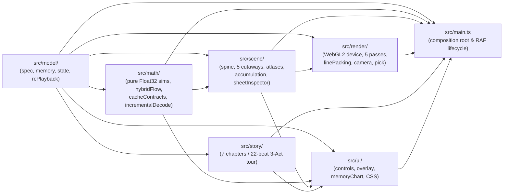

# Architecture Guide — Nemotron 3 Nano Visualization

This guide documents the software architecture, WebGL2 rendering pipeline, mathematical cache ownership invariants, runtime performance architecture, and intentional v1.0 boundaries of **Nemotron 3 Nano 30B-A3B — Architecture Visualization**.

---

## 1. Module Dependency Architecture

The codebase is organized as a strict unidirectional dependency graph with **zero third-party browser runtime dependencies**:

### Layer Responsibilities & Boundaries

| Directory | Responsibility | Strict Boundary |
| --- | --- | --- |
| `src/model/` | Pinned checkpoint metadata (`spec.ts`), logical 1→1M memory math (`memory.ts`), scene/UI state contracts (`state.ts`), and playback/session clocks (`rcPlayback.ts`, `mambaPlayback.ts`, `moePlayback.ts`). | Pure TypeScript; no WebGL or DOM access. |
| `src/math/` | Deterministic miniature Float32 simulators (`gqaSim.ts`, `mambaSim.ts`, `moeSim.ts`), unified 52-layer forward pass (`hybridFlow.ts`), AR decode cache contracts (`cacheContracts.ts`), incremental decoding & branching (`incrementalDecode.ts`), and formula formatting (`formulaFormat.ts`). | **Strictly pure CPU math:** zero DOM, WebGL, or `src/scene/` imports (depends only on `src/model/spec.ts`). Executable identically in Node (Vitest & fixture export) and the browser. |
| `src/scene/` | Pure geometry builders (`spine.ts`, `cutaways.ts`, `embeddingCutaway.ts`, `outputCutaway.ts`, `gqaCutaway.ts`, `gqaSpatial.ts`, `mambaCutaway.ts`, `mambaSpatial.ts`, `moeCutaway.ts`, `moeSpatial.ts`), RG32F value atlas packers (`atlasPacker.ts`, `*Atlas.ts`), focused-cell accumulation (`accumulation.ts`), and sheet inspection (`sheetInspector.ts`). | Emits packed `Float32Array` instance buffers, atlas texels, and CPU ray-pick hitboxes without calling WebGL APIs directly. |
| `src/render/` | Native WebGL2 engine (`device.ts`, `camera.ts`, `pick.ts`, `solids.ts`, `lines.ts`, `linePacking.ts`, `sheets.ts`, `sheetFrame.ts`, `ribbons.ts`). | Owns GPU shaders, VAOs/VBOs, FBOs, and projection/picking math; unaware of domain copy or walkthrough beats. |
| `src/ui/` | Accessible HTML/SVG UI chrome (`controls.ts`, `overlay.ts`, `memoryChart.ts`, `theme.css`) implementing WAI-ARIA tablists, modal focus traps, screen-space elbow callouts, floating cell popovers, and the 1→1M SVG memory scaling chart. | Pure view/controller components driven by state snapshots and callbacks from `src/main.ts`. |
| `src/story/` | Canonical 7-chapter / 22-beat, 3-Act guided walkthrough (`walkthrough.ts`) sharing the 8-token prefill prefix (`TOUR_PREFILL_TOKEN_IDS = [0..7]`) across Act I, Act II, and Act III (`8P + 1S = 9`). | Pure declarative beat metadata & dynamic Act III narrative helpers. |
| `src/main.ts` | Single browser composition root: initializes `RenderDevice`, all 5 GPU passes, `HybridModelParameters`, `DualDecodeSessionStore`, ResizeObserver, pointer/keyboard handlers, WebGL context-loss handlers, and the frame loop. | Sole owner of `requestAnimationFrame` scheduling and live DOM wiring. |

---

## 2. WebGL2 5-Pass Rendering Pipeline & Runtime Performance

### `RenderDevice` (`src/render/device.ts`)

- Creates a native WebGL2 context (`alpha: false`, `depth: true`) backed by an offscreen `RGBA8` + `DEPTH_COMPONENT24` framebuffer at up to **4× MSAA** (probing `getInternalformatParameter` for the highest mutually supported sample count `<= 4`, falling back cleanly to single-sample when MSAA is unavailable).
- Resolves multisampled color via a single-sample resolve FBO and blits cleanly to the canvas default backbuffer.
- Tracks an `fboAllocFailed` non-retry latch and explicitly destroys partially allocated FBO/renderbuffer handles on null, incomplete, or exception paths (reset on resize, `destroyFramebuffer()`, or `markLost()`).

### Five GPU Render Passes

All 5 passes are created at boot and recreated atomically on `webglcontextrestored`:

1. **`SolidsPass` (`src/render/solids.ts`)** — Instanced unit cuboids (`48 B`/instance) rendering the 52-layer Tower, structural housings, and bookend plates with directional shading, procedural face-local hatching, and BF16-gold / FP8-frosted styling (`POLYGON_OFFSET_FILL` enabled to prevent hairline z-fighting).
2. **`LinesPass` (`src/render/lines.ts`) + `linePacking.ts` (`src/render/linePacking.ts`)** — Depth-tested, screen-space antialiased hairlines packed in the authoritative **18-float (`72 B`)** per-instance layout (`LINE_INSTANCE_FLOATS = 18`, `LINE_INSTANCE_ATTRIBS`):
   - `iPointA` (`[0..2]`), `iPointB` (`[3..5]`), `iCssWidth` (`[6]`), `iStyle` (`[7]`: neutral, active, guide, BF16 gold), `iAlpha` (`[8]`), `iOwnerId` (`[9]`), `iFace0`/`iFace1` (`[10..11]`), `iOwnerCenter` (`[12..14]`), `iOwnerExtent` (`[15..17]`).
   - Uses homogeneous Liang-Barsky frustum clipping and perspective front-face edge culling (`face0 = face1 = -1` disables backface culling for free guide lines).
   - Shared across `spine.ts` and all 8 cutaway builders via `pushFreeGuideLine`, `pushBoxFrameXZ`, and `pushDashedFrameXZ`, preventing stride drift across builders.
3. **`SheetsPass` (`src/render/sheets.ts`)** — Arbitrarily oriented 3D thin tensor matrix sheets (`20`-float / `80 B` main instance + optional `6`-float orthonormal basis `iAxisU`/`iAxisN` + optional `4`-float progressive reveal frontier `iReveal`), staying within `13` vertex attribute locations (`<=` WebGL2 guaranteed minimum `16`).
   - Renders crisp adaptive `fwidth()` cell-grid lines (adapted from `bbycroft/llm-viz`) and samples live scalar values from a single **`RG32F` Float32 texture atlas** (`R` = Float32 tensor value, `G` = causal `-∞` mask flag) consistently on both `+N` and `-N` faces.
   - **Content-Keyed Atlas Caching (`PR-12`)**: `computeValueAtlasContentKey()` hashes view mode, bay ID, execution mode, `executionId`, token count, precision, active head/expert/token selectors, stepper step + discrete term bucket, reduced-motion state, and atlas dimensions. Pointer hover moves within the same head/expert/token skip GPU `texImage2D` re-uploads completely.
4. **`RibbonsPass` (`src/render/ribbons.ts`)** — Instanced translucent 3D dataflow bars and tapered directional arrowheads (`48 B`/instance, `depthMask(false)`, straight alpha blending).
5. **`FlatFlowRibbonsPass` (`src/render/ribbons.ts`)** — Dynamic 3D cubic Bezier and polyline flow ribbons with optional cross-fins (`crossRibbon`) and flush double-sided cell/span highlights (`addCellHighlightOnFrame`) rendered along oriented `SheetFrame3D` planes, with pulse animation gated strictly to active playback.

### WebGL Context-Loss Recovery (`PR-10`)

- **`webglcontextlost`**: Calls `ev.preventDefault()`, cancels any active camera fly, pending hover pick, and `requestAnimationFrame` handle; pauses all stepper, Mamba temporal, MoE cycling, and Tower spine-wave clocks; clears `lastUploadedAtlasKey` and `lastOverlayRenderKey`; calls `device.markLost(true)`; and displays an accessible fallback banner while keeping the sidebar controls, guided walkthrough text, and interactive `1 → 1M` memory chart fully operational.
- **`webglcontextrestored`**: Constructs fresh instances of all 5 GPU passes (`SolidsPass`, `SheetsPass`, `LinesPass`, `RibbonsPass`, `FlatFlowRibbonsPass`) into local variables before swapping references, resets cache keys, clears `device.markLost(false)`, hides the fallback banner, marks geometry dirty, and renders synchronously. If pass reconstruction fails, `device.markLost(true)` remains set and an accessible recovery-failed notice stays visible.

### Idle-RAF, Hover-Coalescing & Spine-Throttle Architecture (`PR-11`–`PR-14`)

- **Zero Idle RAF Spin (`PR-11`)**: `shouldAnimateCutawayPulse()` and `shouldContinueRafLoop()` permit continuous `requestAnimationFrame` loops **only** when a camera fly animation, an unpaused Tower spine replay, or an active cutaway playback loop is advancing frames (and WebGL is live and `reducedMotion` is false). Static inspection, pinned cells, hover, and paused steppers render strictly on demand.
- **Hover-Coalescing & Cached Insets (`PR-12`)**: `pointermove` CPU ray-picks are coalesced to at most one pick per animation frame via `pendingHoverRafId`. Cutaway viewport insets (`cachedCutawayInsets`) are cached outside per-frame hot paths, and DOM/SVG overlay sync short-circuits via `lastOverlayRenderKey`.
- **Lightweight Stepper Progress Sync (`PR-13`)**: Between discrete operand-term transitions during 60 fps Math Stepper playback, `controls.syncStepperProgressOnly()` updates only the scrub range input instead of rebuilding the sidebar DOM.
- **Discrete Spine-Wave Geometry Throttling (`PR-14`)**: `computeSpineWaveGeometryKey()` maps continuous replay progress `∈ [0, 1]` onto discrete stage/bay keys (`embedding`, `bay:1..52`, `final_norm`, `output`, `idle`), reducing `buildMacroSpine()` geometry rebuilds over a `5.5 s` (`330`-frame) instructional replay from `330` rebuilds down to `~55` discrete transitions while `syncSpineWaveHud()` smoothly updates the lightweight HUD.

---

## 3. Mathematical Execution, Cache Ownership & Memory Bounds

### Model Parameter Ownership & Weight LRU (`src/math/hybridFlow.ts`)

- `HybridModelParameters` separates immutable model weights from per-run executions (`HybridExecutionResult`) and incremental steps (`HybridIncrementalStepResult`).
- Every parameter instance carries a canonical 64-bit `parameterFingerprint` computed over seed, full layer pattern, `d`, `vocabSize`, IEEE-754 float64 bits of `rmsNormEps` and `residualOutputScale`, and vocabulary strings (`dc0568e222e22a4e` for `createDefaultHybridModel()`).
- Deterministic bay weights (`getBayWeights(bayId)`) are retained in a bounded LRU cache defaulting to **`DEFAULT_MAX_RETAINED_WEIGHT_BAYS = 52`** (all 52 bays + embedding/output = `299,192` Float32 values = **`1,196,768 B` ≈ `1.14 MiB`**).
- Shared read-only `Float32Array` parameter views are reused across executions, decode steps, and layer traces — eliminating per-step PRNG thrash and preventing duplicate weight buffer retention across multi-branch AR sessions.

### Immutable-by-Contract `HybridDecodeCacheState` (`src/math/cacheContracts.ts`, `src/math/incrementalDecode.ts`)

Every cached AR decode snapshot enforces strict ownership and provenance contracts:

1. **Private Non-Aliased Backing Buffers (Copy-on-Step)**:
   - Every `HybridDecodeCacheState` and nested `GqaLayerKvCache` / `MambaLayerBoundaryState` owns private, non-aliased `ArrayBuffer`s. Stepping or forking from `prevState` never mutates any typed array inside `prevState`.
   - Exact default miniature snapshot accounting (`L = 52`, `23 M`, `6 *`, `23 E`, `maxTokens = 16`):
     - Mamba-2 fixed state (`convState` `[128, 4]` + `ssmState` `[16, 4, 4]`): `23 × 3,072 B = 70,656 B` (**`69.00 KiB`**)
     - GQA KV allocated (`K` + `V` `[8, 16]`): `6 × 1,024 B = 6,144 B` (**`6.00 KiB`**; populated = `384 B/token` = `0.375 KiB/token`)
     - MoE sequence cache: **`0 B`** (stateless across tokens)
     - **Total allocated default snapshot:** **`76,800 B = 75.00 KiB`** exactly (excluding JS objects and educational traces).
2. **Digest Verification (`stateDigest` + Length-Prefixed Labels)**:
   - `computeDecodeStateDigest()` computes a deterministic 64-bit dual hash over `parameterFingerprint`, `processedTokens`, `maxTokens`, `prefixTokenIds`, **length-prefixed `prefixTokenLabels`** (preventing concatenation collisions such as `["ab","c"]` vs `["a","bc"]`), and every populated Float32 element of all 23 Mamba and 6 GQA caches (excluding trailing unpopulated KV slots `k >= seqLen`).
   - `validateDecodeCacheState()` verifies complete layer coverage (`23 M`, `6 *`, `23 E`), exact tensor dimensions, non-aliased backing buffers, finite populated values, matching `parameterFingerprint`, and exact `stateDigest` equality — immediately rejecting in-place tampering or cross-model state reuse.
3. **Isolated Lazy-Reconstruction Snapshots**:
   - By default, each step retains full simulator traces eagerly for primary cutaway bays (`DEFAULT_RETAINED_TRACE_BAYS = [1, 2, 6, 42, 43, 52]`, reported as `traceOrigin: 'computed_this_step'`).
   - Requesting any other bay `1..52` via `getLayerTrace(bayId)` deterministically reconstructs that bay (`traceOrigin: 'reconstructed_from_checkpoint'`) from private cloned boundary `Map`s and detached `residualStreams` checkpoints captured inside internal closures. Even if a caller mutates exposed `residualStreams`, `X_embed`, or `ReadonlyMap` containers at runtime, lazy reconstruction remains uncorrupted.
4. **Bounded Decode Branch History (`HybridDecodeSession`)**:
   - Defaults to **`maxBranches = 16`** (`DEFAULT_SESSION_MAX_BRANCHES`) and **`maxUniqueSteps = 128`** (`DEFAULT_SESSION_MAX_UNIQUE_STEPS`), with `pruneInactiveStepTraces: true` dropping reconstructible eager traces from inactive historical steps while deduplicating shared prefix steps across surviving branches.
   - `deleteDecodeSessionBranch()` and `pruneDecodeSessionBranches()` are strictly **active-branch-safe**: they refuse to delete `activeBranchId` (or the last remaining branch), never truncate `activeBranchId`, prune only the oldest inactive branches, and never destroy shared ancestor steps still referenced by surviving branches.
   - `DualDecodeSessionStore` (`src/model/rcPlayback.ts`) completely isolates the canonical Guided Tour AR session (`tour`, seeded from `TOUR_PREFILL_TOKEN_IDS = [0..7]`) from the user's `freeExplore` AR session (`[0, 1, 2, 3]` default prompt + user branches).

---

## 4. Deferred Technical Debt & Future TwoTower Extension Points

### Intentionally Kept Simple for Nano v1.0

The following trade-offs are deliberate v1.0 scope boundaries rather than accidental omissions:

- **Single Composition Root (`src/main.ts`)**: `src/main.ts` (~4.2k LOC) directly coordinates state, GPU passes, camera choreography, and DOM bindings without a client framework or event-bus abstraction. Decomposition into feature controllers is deferred until a second model family requires multi-architecture routing.
- **Miniature CPU Simulation Scale**: `src/math/` intentionally targets fixed miniature dimensions (`d = 8`, `V_mini = 32`, `maxTokens = 16`) with deterministic synthetic Float32 weights for instant sub-millisecond interactive inspection and bit-exact incremental equivalence, without WebGPU compute shaders, WASM tokenizers, or real checkpoint streaming.
- **Metadata-Only FP8 Selective Mode**: `[ BF16 | FP8 Selective ]` drives exact production memory accounting (`src/model/memory.ts`) and 3D visual boundary highlights (`src/model/spec.ts`) without simulating hardware FP8 E4M3 quantization noise inside the miniature Float32 forward pass.
- **Nano-Specific Cutaway Builders**: The 5 cutaway builders encode Nemotron 3 Nano's specific `M`/`E`/`*` + NoPE bookend topologies rather than a generic graph-layout DSL.

### Ready Seams for Future TwoTower Capabilities

The v1.0 math and cache contracts were specifically designed so future **TwoTower** (e.g., hybrid encoder-decoder, cross-tower memory transfer, or diffusion-assisted hybrid) visualizations can extend the engine cleanly without rewriting core primitives:

| Future TwoTower Capability | Existing v1.0 Seam | How It Plugs In |
| --- | --- | --- |
| **Layer-Aligned KV Transfer** | `GqaLayerKvCache` (`cacheContracts.ts`) & `createExternalDecodeCacheState()` (`incrementalDecode.ts`) | Already accepts externally supplied per-layer `K`/`V` `Float32Array` caches keyed by `bayId`, with defensive cloning, explicit `maxTokens >= seqLen` capacity validation, unambiguous stride checking, and `stateDigest` binding — ready for encoder-to-decoder or tower-to-tower KV projection transfer. |
| **Externally Seeded Mamba States** | `MambaLayerBoundaryState` & `ExternalDecodeCacheSeed` (`cacheContracts.ts`, `mambaSim.ts`) | Both TypeScript `runMambaSim` and PyTorch `mamba2_forward_ref` already support arbitrary non-zero `(convState, ssmState)` boundary seeds validated end-to-end across all 23 Mamba bays, enabling cross-tower recurrent state handoff or prefix compression injection. |
| **Bidirectional Block Attention** | `gqaSim.ts` causal mask stage & `SheetsPass` `RG32F` `G`-channel mask bit | Causal masking is isolated to the score mask predicate (`k > q_pos` → `-Infinity`) and signaled to GPU shaders solely through the `G` channel of the `RG32F` atlas. Replacing the scalar predicate with a block-bidirectional / prefix-LM mask extends both math kernels and `Scores`/`Softmax` rendering with zero shader changes. |
| **Timestep Conditioning** | `HybridModelConfig`, `parameterFingerprint`, & `applyRmsNorm` (`hybridFlow.ts`) | Because model configuration and fingerprinting are centralized and decoupled from execution inputs, adding timestep embeddings and AdaLN `(scale, shift)` conditioning hooks cleanly onto pre-norm stages while preserving `src/math/` purity and PyTorch parity testing. |
| **Diffusion Refinement Loops** | `HybridDecodeSession` lineage (`IncrementalStepProvenance`, `stepExecutionId`, `branchId`, `DualDecodeSessionStore`) | The immutable copy-on-step lineage graph (`initialStateDigest → parentStepExecutionId → stepExecutionId`, bounded branch history, and lazy per-layer trace reconstruction) generalizes naturally from autoregressive token appends (`S = 1`) to iterative denoising refinement passes (`k = 0..K`) over fixed or block-wise token windows. |
