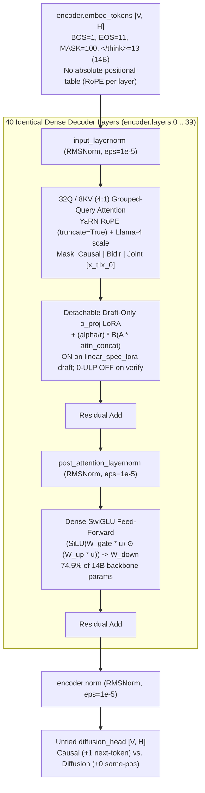

# Nemotron-Labs-Diffusion-14B — Architecture & Checkpoint Audit Guide

This guide documents the pinned provenance, 3-tier epistemic sourcing contract, 40-layer homogeneous dense Ministral 3 decoder architecture, projection-width reversal disclosure, exact dyadic YaRN RoPE + Llama-4 query temperature scaling, 4-path execution engine with strict Sampler A vs. B separation, 40-layer shared-slab KV rollback and `<= 12.00 MiB` retention proof, 4-tier context-scaling honesty contract, verified `0 B` 13-file LFS inventory, `D1–D24` discrepancy ledger, and 3-way Topology A multi-entry isolation contract for **NVIDIA Nemotron-Labs-Diffusion-14B** (`/diffusion/`).

For single-tower **Nemotron 3 Nano 30B-A3B** (`/`), see [`docs/ARCHITECTURE.md`](ARCHITECTURE.md). For dual-tower **Nemotron-Labs-TwoTower 30B-A3B** (`/twotower/`), see [`docs/TWOTOWER_ARCHITECTURE.md`](TWOTOWER_ARCHITECTURE.md). For interactive usage instructions, see [`docs/DIFFUSION_USER_GUIDE.md`](DIFFUSION_USER_GUIDE.md).

---

## 1. Pinned Provenance & 3-Tier Epistemic Sourcing Matrix

### Pinned Reference Identifiers

| Artifact | Pinned Identifier | Verification Notes |
| --- | --- | --- |
| **Canonical HF Checkpoint** | `nvidia/Nemotron-Labs-Diffusion-14B` | Canonical 14B Instruct checkpoint (`created` / pinned commit `2026-06-03T17:58:02Z`). Note: `nvidia/NVIDIA-Nemotron-Labs-Diffusion-*` returns HTTP 401; all 7 public repos omit `NVIDIA-` (`D2`). |
| **Pinned HF Revision** | `f8c3e2c078e193599b8882d965b1001c456ba738` | Full 40-char commit SHA pinned in `src/diffusion/spec.ts`. |
| **Reference GitHub Repo** | `NVlabs/Nemotron-Labs-Diffusion` @ `2aabcf75ecf70264d4047ff090d842450853f2e4` | Upstream release commit (`2026-06-03T18:14:25Z`); clean-room mathematical reference only (`Apache-2.0` code / `NVIDIA Open Model License` weights). |
| **Technical Paper** | `arXiv:2607.05722v1` | *Nemotron-Labs-Diffusion* (`2026-07-07`, 21 pages). |
| **Out-of-Scope Sister Repo** | `NVlabs/Nemotron-Labs-Diffusion-Uni` (`16916949402ca738dcc74a7a37e0c43facafe347`, `arXiv:2610.36466`) | Explicitly out of scope (`inScope: false`): separate later unified visual understanding + visual generation DLLM repository (`2026-10-27/28`). |

### 3-Tier Epistemic Sourcing Matrix

| Epistemic Tier | Source & Scope | Exact Examples | Boundary / Non-Redistribution Guarantee |
| --- | --- | --- | --- |
| **Tier 1 · Directly Inspected Public Metadata** | Verbatim fields from pinned HF `config.json`, `tokenizer_config.json`, `linear_spec_lora/adapter_config.json`, safetensors headers, and HF LFS metadata across all 7 repos (`14B`, `14B-Base`, `8B`, `8B-Base`, `3B`, `3B-Base`, `VLM-8B`). | `Ministral3Model` dense backbone (`40` layers, `H = 5,120`, `intermediate = 16,384`, `32Q / 8KV`, `head_dim = 128`, `q_proj = 4,096`), `V = 131,072` (`BOS = 1`, `EOS = 11`, `MASK = 100`, `</think> = 13`), `rope_theta = 1e9`, YaRN `factor = 16.0`, `origMaxPos = 16,384`, `truncate = True`, Llama-4 `beta = 0.1`, `max_pos = 262,144`, `o_proj` LoRA (`r = 128, α = 512`). | **Zero NVIDIA Python source files, model weights, LoRA safetensors, or tokenizers are stored in Git or bundled in `dist/`.** |
| **Tier 2 · Analytically Derived Quantities** | Closed-form arithmetic reconciled against safetensors header byte sizes (`0 B` diff across all `13` LFS files) and KV cache equations (`src/diffusion/spec.ts`, `src/diffusion/archReadouts.ts`). | `13,506,073,600` backbone params / `27,012,147,200 B` = **`25.16 GiB (27.01 GB)`** BF16 (`363` tensors); `47,185,920` (`47.19M`, `+0.35%`) LoRA params / `188,743,680 B` = **`180.00 MiB (188.74 MB)`** FP32 (`80` tensors); `160.00 KiB/tok` (`163,840 B/tok`) 14B BF16 KV; 4-tier context scaling. | Analytical payload totals only; explicitly separated from peak runtime inference activations & allocator workspace. |
| **Tier 3 · Synthetic Miniature Browser Execution** | Clean-room deterministic TypeScript forward passes (`src/diffusion/`) executed live in browser & Node on synthetic seeded Float32 weights, cross-checked against offline **PyTorch `2.15.0`** parity fixtures across Categories 1–12. | `40` physical layers, `d = 8`, `dFf = 24`, `32Q / 8KV`, `dHead = 8`, `V = 36`, `rLora = 4, α = 16, scale = 4.0`, `363` backbone tensors (`229,064` floats = `894.78 KiB`) + `80` LoRA tensors (`42,240` floats = `165.00 KiB`), `20.00 KiB/tok` shared KV slabs, hard cap `<= 12.00 MiB`. | Executes exact Ministral 3 / NLD equations at miniature scale — **NOT** `14B` checkpoint weights, real tokenizer logits, or speed benchmarks. |

---

## 2. Single 40-Layer Homogeneous Dense Decoder Architecture

Unlike Nano and TwoTower's 52-layer hybrid Mamba-MoE-GQA spines, **Nemotron-Labs-Diffusion-14B** is a **single homogeneous 40-layer dense decoder** derived from **Ministral 3 (`Ministral3Model`)** (`D1`, `D14`):

### Explicit Projection-Width Reversal Disclosure (`Mini` vs. `14B`)

Both `gqa_rope`, `macro`, and `Architecture` readouts explicitly surface the **projection-width reversal** between the miniature simulator and canonical 14B production:

| Dimension / Property | Miniature Simulator (`DIFFUSION_MINI_CONFIG`) | Canonical 14B Instruct (`nvidia/Nemotron-Labs-Diffusion-14B`) |
| --- | --- | --- |
| **Physical Layers** | **`40`** (`encoder.layers.0..39`) | **`40`** (`encoder.layers.0..39`) |
| **Hidden Width `H` / `d_ff`** | `d = 8` / `dFf = 24` | `H = 5,120` / `intermediate = 16,384` (`74.53%` of backbone in SwiGLU) |
| **GQA Heads & `head_dim`** | `32Q / 8KV` (`4:1`), `dHead = 8` | `32Q / 8KV` (`4:1`), `head_dim = 128` |
| **`q_proj` / `kv_proj` Width** | **`qConcat = 256`, `kvConcat = 64` (EXPANSION `8 → 256`)** | **`q_proj = 4,096`, `kv_proj = 1,024` (CONTRACTION `5,120 → 4,096`)** |
| **Vocabulary `V` (untied)** | **`36`** (`0..31` words, `32` `[MASK]`, `33` `<|im_end|>`, `34` `<s>`, `35` `</think>`) | **`131,072`** (`BOS = 1`, `EOS = 11`, `MASK = 100`, `</think> = 13`) |
| **Draft-Only `o_proj` LoRA** | `r = 4, α = 16, scale = 4.0` (`80` F32 tensors · `42,240` floats = `165.00 KiB`) | `r = 128, α = 512, scale = 4.0` (`80` F32 tensors · `47.19M` params = `180.00 MiB` / `188.74 MB`) |
| **YaRN RoPE & Llama-4** | `θ = 16`, `factor = 4.0`, `origMaxPos = 16`, `truncate = True`, `β = 0.1` | `θ = 1e9`, `factor = 16.0`, `origMaxPos = 16,384`, `truncate = True`, `β = 0.1`, `max_pos = 262,144` |
| **KV Slab Size (`40L`)** | `20.00 KiB/tok` (`20,480 B/tok`, Float32) · `kvCapacity = 32` | `160.00 KiB/tok` (`163,840 B/tok`, BF16) |

---

## 3. Exact Dyadic YaRN RoPE & Llama-4 Query Temperature Scaling

Every layer injects position through Ministral 3's **YaRN RoPE** with `truncate = True` and **Llama-4 query attention temperature scaling** (`src/diffusion/rope.ts`):

1. **Exact Dyadic YaRN Inverse Frequencies (`DIFFUSION_DYADIC_YARN_INV_FREQ`):**
   - With miniature parameters `headDim = 8`, `rope_theta = 16.0`, `originalMaxPositionEmbeddings = 16`, `factor = 4.0`, `beta_fast = 32.0`, `beta_slow = 1.0`, and `truncate = True`, the 4 rotary planes `(0,4)`, `(1,5)`, `(2,6)`, `(3,7)` evaluate to exact dyadic binary fractions with **`0`-ULP** floating-point parity against PyTorch `2.15.0`:
     - Plane `0` `(0,4)`: **`1.0`** (`original` zone)
     - Plane `1` `(1,5)`: **`0.3125`** (`5/16`, `blended` zone)
     - Plane `2` `(2,6)`: **`0.0625`** (`1/16`, `interpolated` zone)
     - Plane `3` `(3,7)`: **`0.03125`** (`1/32`, `interpolated` zone)
2. **Llama-4 Query Temperature Scale (`computeLlama4AttnScale`):**
   - `s_L4(p) = 1.0 + β · ln(1.0 + ⌊p / origMaxPos⌋)` with `β = 0.1`.
   - For `p < 16` (`origMaxPos = 16` in miniature; `16,384` in 14B production), `s_L4(p) = 1.0000` identically.
   - At `p = 16` (or `16,384` in production), **`s_L4` jumps discretely from `1.0` to `1 + 0.1 · ln(2) ≈ 1.06931472` (`+6.93%`)**, scaling **only `Q_rot`** (`q_scaled = q_rot * s_L4(p)`) while **`K_rot` stays on the unit radius `r = 1.0`**!
3. **3-Coordinate Divergence (`seqIdx`, `ropePositionIds`, `cachePositions`, `D23`):**
   - During BD3-LM Joint Training (`[x_t ‖ x_0]` of length `2L`), `cache_position` advances across `0..2L-1` while `rope_position_ids` repeat `0..L-1` for both streams; at `L = 16,384`, `x_0` receives Llama-4 boost `1.069315` while `x_t` remains `1.0`. The 5-tab Mask Explorer explicitly surfaces all three coordinates and enforces `M_OBC` strict offset `Δp >= 1` (`0` twin leakage).

---

## 4. 4-Path Execution Engine, Strict Sampler A vs. B Separation & Guards

All 4 released text inference paths execute deterministically in pure TypeScript (`src/diffusion/execution.ts`, `src/diffusion/speculative.ts`, `src/diffusion/sampler.ts`, `src/diffusion/session.ts`) with **zero `Math.random()`** (`Xoshiro128**` PRNG):

| Mode (`DiffusionExecutionMode`) | KV Provenance (`kvMaskProvenance`) | `o_proj` LoRA State | Sampler & Mechanics |
| --- | --- | --- | --- |
| **`ar`** (`ar_generate`) | `token_causal` | OFF (`0`-ULP base) | Explicit causal mask (`D8` fix); 1 token per decode step; `referenceMethodNfe = G` (includes prefill). |
| **`dlm`** (`generate`, `causal_context = true`) | `token_causal` | OFF (`0`-ULP base) | Slot `0` AR-seeded from prior causal logits (`D7`), `B-1` `[MASK]` slots; transient denoise concat (`use_cache = False`, `D6`), **Sampler A** unmasking, causal commit (`use_cache = True`). |
| **`dlm`** (`generate`, `causal_context = false`) | `block_bidirectional` | OFF (`0`-ULP base) | Requires explicit re-prefill (`KvProvenanceMismatchError` guard); all `B` slots start `[MASK]`; bidirectional block commit. |
| **`linear_spec`** (`linear_spec_generate`) | `token_causal` | OFF (`0`-ULP base) | **Sampler B** drafts `B-1` proposals (`use_cache = False`) -> 1 causal verify pass checks `ar_tokens[i] == block[i+1]` (`D11`) -> `_crop_dynamic_cache` rollback on mismatch. |
| **`linear_spec_lora`** (`linear_spec_generate`) | `token_causal` | **ON on draft only; `0`-ULP OFF on verify (`D17`)** | Stateless per-call `loraEnabled` flag applies `+4.0 · B(A · a)` on draft passes and disables LoRA identically on verify passes. |

### Key Safety & Honesty Contracts

- **Strict Sampler A vs. Sampler B Separation:**
  - **Sampler A (`runSamplerATransferStep`, DLM):** Temperature-scaled confidence gating, `k = 0` unconditional floor (`quota`), `>` vs. `>=` threshold rule, and raw un-suppressed `[MASK]` logits (never silently clamping `[MASK]`).
  - **Sampler B (`runSamplerBDraftStep`, Linear Spec):** When `threshold = 0.0`, commits all slots in 1 pass; when `threshold > 0`, enforces **`D18` Guard** (`maxDraftPassesPerCycle = B` + `non_progress_mask_loop` break) so un-suppressed greedy `[MASK]` argmax cannot loop infinitely.
- **Clarification #1 (`D19` Dual-Crop Provenance):** On EOS inside an accepted speculative prefix, the browser crops KV cleanly to `browserPostEosCropLen = cache_len + first_eos + 1` while recording `upstreamPreEosCropLen = cache_len + accepted` in provenance.
- **Clarification #2 (`kvCapacity` Tail-Block Boundary):** Never silently clamps `B` down to `1`; halts cleanly with `lifecyclePhase = 'capacity_exhausted'` whenever `kvCapacity - cache_len < B` (and `< 1` for `ar`).
- **`D12` 3-Counter NFE Transparency:** Always reports `actualForwardPasses`, `decodeForwardPasses`, and `referenceMethodNfe` side-by-side (`ar` & `linear_spec*` include prefill; `dlm` `referenceMethodNfe` excludes prefill; prefill-EOS on `dlm` costs `actual = 3, decode = 2, ref = 2` per `D21`).

---

## 5. 40-Layer Shared-Slab KV Rollback & `<= 12.00 MiB` Memory Proof

- **Immutable Per-Position Shared KV Slabs (`src/diffusion/kvCache.ts`):** Each committed position stores one immutable `KvPositionSlab` (`20.00 KiB/tok` = `20,480 B/tok` across all `40` layers × `K,V` × `64` floats × `4 B`). Parent/child records and speculative rollback prefixes share exact `ArrayBuffer` references without copying.
- **Active-Only Trace Retention & `0`-ULP Lazy Reconstruction (`src/diffusion/session.ts`):** `eagerLayerTraces` (layers `[0, 19, 39]`) and `activeCroppedSuffixSlabs` live **only** on the active cursor record and are evicted from all historical records on every step, seek, or reset. Seeking any historical record reconstructs non-eager layers and speculative cropped suffixes at **`0`-ULP** bit-exactness.
- **Category 12 Adversarial Stress Result (`tests/diffusion-guards-memory.test.ts`):** Under `12` branches / `128` records of repeated `B = 8` speculative rejection cycles, deduplicated `Set<ArrayBufferLike>` accounting measures **`5,097,012 B` (`4.86 MiB <= 12.00 MiB` hard cap)** across `145` unique shared slabs (`6,895` unique buffers).

---

## 6. 4-Tier Context Honesty Contract & `0 B` 13-File LFS Inventory

### 4-Tier Context Honesty Contract (`DIFFUSION_CONTEXT_TIERS`)

| Tier | Token Span / Points | Badge | Provenance & 14B BF16 KV (`160.00 KiB/tok`) |
| --- | --- | --- | --- |
| **Tier 1** | `4,096` (Base Stage 2) · `16,384` (Instruct SFT) | `Verified Training` | Paper §5.1–§5.2 training lengths; matches `origMaxPos = 16,384` (`s_L4 = 1.0000×`; `2.50 GiB` KV at `16K`). |
| **Tier 2** | `512` (CLI) · `1,024` (SPEED-Bench) · `2,048` (SGLang Spark) · `20,480` (`eval.sh` dLM/Spec) · `65,536` (`eval.sh` AR) | `Harness / Benchmarked Cap` | Verified repo harness & evaluation script bounds (`3.125 GiB` at `20K`, `10.00 GiB` at `64K`). Zero published long-context evals exist in `arXiv:2607.05722v1`. |
| **Tier 3** | `16,385 .. 262,144` (`256K`) | `Configured YaRN Ceiling (Unverified)` | Inherited Ministral 3 YaRN `factor = 16.0` + `llama_4_scaling_beta = 0.1` (`40.00 GiB` KV at `256K`); not empirically validated in paper. |
| **Tier 4** | `> 262,144` (`512K`, `1M`) | `Analytical Extrapolation` | Pure linear `+160.00 KiB/tok` scaling beyond `max_position_embeddings = 262,144`. |

### Verified `0 B` 13-File LFS Inventory (`DIFFUSION_LFS_INVENTORY`)

All `13` safetensors files across the 7 Hugging Face repositories (`14B`, `14B-Base`, `8B`, `8B-Base`, `3B`, `3B-Base`, `VLM-8B` [4 shards]) plus the 3 `linear_spec_lora/adapter_model.safetensors` files reconcile `headerBytes + payloadBytes == hfLfsSizeBytes` with **`0 B` diff**:

- **Canonical `14B` Backbone (`model.safetensors`):** `363` `BF16` tensors · `13,506,073,600` params · `27,012,147,200 B` (**`25.16 GiB / 27.01 GB`**) payload + `43,512 B` header = `27,012,190,712 B` (`diffBytes = 0`).
- **Canonical `14B` Draft LoRA (`linear_spec_lora/adapter_model.safetensors`):** `80` `F32` tensors · `47,185,920` (`47.19M`, `+0.35%`) params · `188,743,680 B` (**`180.00 MiB / 188.74 MB`**) payload + `11,120 B` header = `188,754,800 B` (`diffBytes = 0`).

---

## 7. `D1–D24` Verified Discrepancy Ledger Summary

The complete 24-entry ledger (`DIFFUSION_DISCREPANCY_LEDGER` in `src/diffusion/spec.ts`) is searchable and filterable live inside the Inspector's **`Ledger (D1–D24)`** tab across 4 categories:

- **Architecture & Specs (`D1, D2, D5, D13, D14, D15`):** Ministral 3 backbone vs. prior Qwen3 claim (`D1`); `nvidia/Nemotron-*` vs. `nvidia/NVIDIA-*` 401 (`D2`); `BOS=1, EOS=11, MASK=100` (`D5`); Base README `linear_spec_lora` / `inputs.input_ids` copy-paste errors (`D13`); single `self.encoder` + `dlm_paradigm="bidirectional"` vs. dual-encoder docstring (`D14`); exact `13,506,073,600` params `+409,600` RMSNorm vectors & `dlm_loss_weight` (`D15`).
- **RoPE & Masks (`D3, D4, D8, D23`):** YaRN `truncate=True` + Llama-4 scaling + `theta=1e9` (`D3`); `3B-Base`/`8B-Base` `factor=0.25` / `max_pos=4096` export (`D4`); latent `ar_generate` missing `use_causal_mask=True` under eager attention (`D8`); training `[x_t ‖ x_0]` asymmetric Llama-4 scaling (`D23`).
- **Execution & KV Cache (`D6, D7, D12, D16, D17, D19, D20, D21`):** Transient denoise concat vs. spec crop (`D6`); AR-seeded slot 0 in `causal_context=true` (`D7`); 3-counter NFE convention mismatch (`D12`); `kvCapacity` tail-block halt without clamping `B→1` (`D16`); stateful `diffusion_lm` / PEFT LoRA leakage prevented via stateless per-call flags (`D17`); `D19` verify-crop-before-EOS desync; `</think>` seed/KV desync (`D20`); DLM prefill-EOS `nfe=2` / `actual=3` (`D21`).
- **Samplers & Guards (`D9, D10, D11, D18, D22, D24`):** Unshipped 4.8M trained sampler (`D9`); VLM-only Quadratic SS (`D10`); stochastic multinomial equality coupling vs. maximal coupling (`D11`); `D18` infinite `[MASK]` draft loop guard; `maxNewTokens >= 1` (`D22`); VLM greedy-only bug + `sheets.ts` live `RG32F` binding (`D24`).

---

## 8. Shipped Diffusion Modules & 3-Way Topology A Isolation Contract

### Shipped Diffusion Modules (`src/diffusion/`)

| Layer | Modules | Purity & Isolation |
| --- | --- | --- |
| **Headless Math, Spec & Engine** | `src/diffusion/{types,spec,prng,rope,masks,attention,swiglu,parameters,forward,kvCache,sampler,execution,speculative,session,archReadouts,index}.ts` | Pure TypeScript — zero DOM, WebGL, `Math.random()`, or `src/twotower/` imports. |
| **Pure Story & Guided Tour** | `src/diffusion/story/{types,walkthrough}.ts` | Pure headless 4-Act / 26-Beat tour owning an isolated `DiffusionSession` (`0x44463401`). |
| **Pure 3D Spatial Scene Builders** | `src/diffusion/scene/{types,provenance,macroScene,gqaRopeAtlas,gqaRopeCutaway,swigluAtlas,swigluCutaway,maskExplorerScene,specVerifyScene,bookendCutaways,index}.ts` | Generates `Float32Array` geometry and `RG32F` atlases (`256×128` up to `256×256` authorized for `GQA+RoPE+LoRA`; `64×64` for `SwiGLU` & `Mask Explorer`) without WebGL calls. |
| **Browser Shell & Editorial UI** | `src/diffusion/app/{main,spatialApp,spatialOverlay,timelineDock}.ts`, `spatial.css` | Mounted solely by `diffusion/index.html`; runs shared 5-pass WebGL2 pipeline with strict idle-RAF sleep and atlas key deduplication. |

### 3-Way Topology A Bundle-Isolation Metrics (`npm run verify:isolation`)

`vite.config.ts` compiles three isolated entry points (`index.html`, `twotower/index.html`, `diffusion/index.html`) verified on both `/` and `/llm-viz/` by `scripts/verify_bundle_isolation.mjs`:

| Bundle / Entry | Raw Bytes (`/` · `/llm-viz/`) | Gzip Level-9 Bytes (`/` · `/llm-viz/`) | Isolation & Budget Status |
| --- | --- | --- | --- |
| **Nano `v1.0.0`** (`3` JS, `1` CSS) | `765,400 B` (`747.46 KiB`) | **`213,671 B` (`208.66 KiB`)** | `<= 215.00 KiB` (`220,160 B`) cap — **`+6.34 KiB` (`6,489 B`) headroom**, `0` leaks, `0 B` Nano JS/CSS added for quiet `Diffusion ↗` HTML link. |
| **TwoTower** (`2` JS, `1` CSS) | `1,149,770 B` · `1,149,778 B` | **`325,423 B` (`317.80 KiB`)** · **`325,434 B` (`317.81 KiB`)** | `22` `src/twotower/*` sources; `0` Diffusion/Nano leaks. |
| **Diffusion 14B** (`3` JS, `1` CSS) | `1,025,187 B` · `1,025,195 B` | **`301,052 B` (`294.00 KiB`)** · **`301,056 B` (`294.00 KiB`)** | `31` `src/diffusion/*` sources; `0` TwoTower leaks. |
| **Shared Chunks** (`2` JS) | `634,473 B` (`619.60 KiB`) | **`185,159 B` (`180.82 KiB`)** | `assets/controls-*.js` (`54,838 B` gzip, `shared(n+df)`) + `assets/overlay-*.js` (`130,321 B` gzip, `shared(all3)`). |
