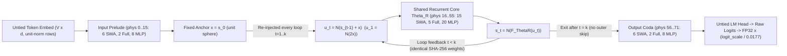

# NVIDIA Nemotron-Labs-Dory1.0-4B — Architecture & Verification Guide

This guide documents the pinned provenance, 5-tier epistemic governance rubric, physical `72`-sublayer looped **Full-Normalized-GPT (nGPT)** topology (`16` Input Prelude + `40` Shared Recurrent Core + `16` Output Coda), `5` learned scaling families (`σ_0 = 0.0177` active divisor), channel-wise NLERP residual contract (`DR7` anti-SLERP), canonical binary32-storage / binary64-accumulation browser numerical contract (`D5`), dual-axis KV cache (`per_loop` vs. `last_loop` × `SWA` vs. `Full`) with `$S$-invariant (4 + 5k) / 9` scaling and `DR17`/`DR24` partition-dependence characterization, reconstructed Paper §6.2 **Contract A** self-speculative decoding (`104` Dual-Coda banks, `DR23`), `0 B` diff 4-checkpoint reconciliation, `D10` `3.00 MiB` LRU sparse-checkpoint pool (`<= 12.00 MiB` bound across `k = 1..8`), `DR1–DR24` discrepancy & browser-guard ledger, and 5-way Topology A bundle-isolation architecture for **NVIDIA Nemotron-Labs-Dory1.0-4B** (`/dory/`).

For sibling architecture guides, see [`docs/ARCHITECTURE.md`](ARCHITECTURE.md) (Nano `/`), [`docs/TWOTOWER_ARCHITECTURE.md`](TWOTOWER_ARCHITECTURE.md) (TwoTower `/twotower/`), and [`docs/DIFFUSION_ARCHITECTURE.md`](DIFFUSION_ARCHITECTURE.md) (Diffusion-14B `/diffusion/`). For interactive usage instructions, see [`docs/DORY_USER_GUIDE.md`](DORY_USER_GUIDE.md).

---

## 1. Pinned Provenance, Epistemic Governance & Scope Boundary

### Pinned Reference Identifiers

| Tier | Source | Pinned Revision / Identifier | Role & Governing License |
| --- | --- | --- | --- |
| **Tier-1A** | Research Paper | `arXiv:2611.03998` (*Dory1.0-4B: A Looped Normalized-GPT*, submitted `2026-11-02`) | Architectural narrative, equations, §6.1–§6.2, quantization & benchmark readouts (**CC BY 4.0**). |
| **Tier-1B** | `nvidia/NVIDIA-Nemotron-Labs-Dory1.0-4B-BF16` | Commit `ee517dd388a9b348890ae1e00dacc5eb4d0c750d` (`7,950,515,472 B` LFS, SHA-256 `207483664dfe...`) | Canonical `BF16` `config.json`, tokenizer metadata, `507`-tensor header (**OpenMDW-1.1**). |
| **Tier-1B** | `nvidia/NVIDIA-Nemotron-Labs-Dory1.0-4B-MXFP8` | Commit `f57fc2d5353e0a3847ae0544c33e5601672f4065` (`4,750,755,304 B` LFS, SHA-256 `2dd3ff9600a6...`) | W8A16 `compressed-tensors` (`795` tensors, MSE E8M0 search `DR15`; **OpenMDW-1.1**). |
| **Tier-1B** | `nvidia/NVIDIA-Nemotron-Labs-Dory1.0-4B-NVFP4` | Commit `17065a6849266dd478221735be7747689a0a4331` (`3,202,498,032 B` LFS, SHA-256 `ca08dec5d70b...`) | W4A16 `modelopt` QAD (`1,083` tensors; **OpenMDW-1.1**). |
| **Tier-1B** | `nvidia/NVIDIA-Nemotron-Labs-Dory1.0-4B-GGUF` | Commit `df53755cb8741843af8e019e088819fbef17e29b` (`3,673,288,864 B` LFS, SHA-256 `96080be49ffd...`) | Official `Q5_K_M` GGUF footprint (`F32` 1D scale tensors; **OpenMDW-1.1**). |
| **Tier-1B** | `huggingface/transformers` | Commit `3a96649547593bacad4b65d43442ccdf15d0ae0f` (PRs `#50099`, `#50982`, `#50993`, `#50523`) | Paired-36L `LayerPairCollapse`, `DoryPastReader`, masking/cache cross-check (**Apache-2.0**; zero code copied). |
| **Tier-1B** | `vllm-project/vllm` | Commit `75fc05a53a366068f534a61ab3ee6b50485419f2` (PR `#60149`) | Physical-72L FP32-scaled reference semantics (**Apache-2.0**; zero code copied). |
| **Tier-1B** | `ggml-org/llama.cpp` | PR `#30306` head `8481bd0fde646c3f0423cd09320fe9b85b5fb0a5` | Physical-72L `dory.cpp`, `get_can_shift() = false`, `last_loop` chunk notes (**MIT**; zero code copied). |

> [!IMPORTANT]
> **Zero Redistribution & Clean-Room Invariant:** Zero production weights, safetensors payloads, GGUF binaries, tokenizers, or upstream source lines from NVIDIA, Hugging Face, vLLM, llama.cpp, or community repositories are stored or redistributed. Every module under `src/dory/` and every PyTorch `2.15.0` reference script under `scripts/reference/` is 100% clean-room original code with zero runtime npm dependencies and zero `Math.random()`.

### Scope Boundary Matrix

| Domain | Canonical Provenance | Browser Visualizer Scope |
| --- | --- | --- |
| **72-Sublayer Full-nGPT Forward (`k ∈ {1..4, 6, 8}`), `per_loop` & `last_loop` KV** | Paper §2–§3, §6.1; HF `BF16/config.json`; `vLLM` `#60149`; `transformers`; `llama.cpp` `#30306` | **Live deterministic miniature execution** (`Float32Array` storage + binary64 accumulation, `D5`) verified against independent PyTorch `2.15.0` fixtures. |
| **Paper §6.2 Self-Speculative Decoding (`k = 1 → 4`, `γ = 4`, Contract A `104` Banks)** | **Paper §6.2 only** (absent from upstream runtimes; Coda KV history omitted in paper `DR23`) | **Live deterministic miniature execution (`D3`)**, strictly badged **`Reconstructed from Paper §6.2 (Contract A) · Not in Upstream Runtimes · per_loop Only`**. |
| **4-Checkpoint Quantization (`BF16 / MXFP8 / NVFP4 / Q5_K_M`), 3-Stage Pretraining, TBPTL Depth-1, GRPO RLVR & Paper Benchmarks** | Paper §3–§5; 4 pinned HF checkpoint headers (`0 B` diff) | **Strictly read-only metadata, static analytical curves & `READ-ONLY · NO GRADIENTS` schematic** (zero fake quantization toggles, zero training/RLVR loops). |

---

## 2. Canonical Physical-72 Topology & Miniature Geometry (`D1`, `D2`)

**Decision `D1`:** Dory adopts the checkpoint/Paper/`vLLM`/`llama.cpp` **physical `0..71` single-sublayer convention** (`16` Input Prelude + `40` Shared Recurrent Core + `16` Output Coda; effective executed depth `32 + 40k ∈ {72, 112, 152, 192, 272, 352}`) while surfacing the paired `transformers` index badge (`Pair L{⌊p/2⌋}`) in every inspector and coordinate strip.

Every stage repeats the exact **8-sublayer (`4`-paired) motif `[SWA, MLP, SWA, MLP, SWA, MLP, Full, MLP]`**:
- **Input Prelude (`0..15`, runs `1×`):** `6` SWA + `2` Full + `8` MLP (`Pair L0..L7`).
- **Shared Recurrent Core (`16..55`, runs `k×` with identical weights):** `15` SWA + `5` Full + `20` MLP (`Pair L8..L27`).
- **Output Coda (`56..71`, runs `1×`):** `6` SWA + `2` Full + `8` MLP (`Pair L28..L35`).

### Production vs. Miniature (`DORY_MINI_CONFIG`, Locked `D2`)

| Hyperparameter | Production `Dory1.0-4B` (`ee517dd3`) | Miniature `DORY_MINI_CONFIG` | Scaling Disclosure |
| --- | ---: | ---: | --- |
| **Physical Sublayers / Tensors** | `72` (`16+40+16`) / `507` `BF16` | **`72` (`16+40+16`) / `507` `F32`** | `1:1` physical topology & tensor inventory (`93,248` floats = `372,992 B` = `0.356 MiB`, SHA-256 `cd3a8ad3...`). |
| **Hidden Width `d` / `d_ff`** | `2,560` / `7,168` (`2.80×`) | **`8` / `24` (`3.00×`)** | Matches Nano, TwoTower, Diffusion-14B & NLD-Uni's `d = 8` residual sheet grammar. |
| **Attention Heads & `head_dim`** | `16Q / 4KV` (`4:1`), `d_h = 256` | **`8Q / 2KV` (`4:1`), `d_h = 8`** | `4` NeoX rotary planes; `q_dim = 64` (`8.00× d` mini vs. `4,096 = 1.60× d` prod), `kv_dim = 16` (`2.00× d` mini vs. `1,024 = 0.40× d` prod). |
| **Vocabulary `V` (untied)** | `131,072` (`tie_word_embeddings: false`) | **`64`** (untied) | Preserves exact production special IDs (`0=<unk>, 1=<s>, 2=</s>, 10=<|im_start|>, 11=<|im_end|>, 12=<think>, 13=</think>, 14=<tool_call>, 15=</tool_call>`). |
| **Context `S_max` / SWA Window `W`** | `262,144` / `1,024` | **`32` / `8`** (`cap_swa = 16`) | `S = 12` default prompt crosses `W = 8` eviction immediately; `cap_swa = 16 >= W + γ + 1 = 13` enables `DR19` rollback. |
| **Dual RoPE (`100%` NeoX `rotate_half`)** | `θ_S = 10,000` / `θ_F = 10,000,000` | **`θ_S = 16` / `θ_F = 1,024`** | Exact dyadic SWA `inv_freq = [1, 1/2, 1/4, 1/8]` vs. Full `[1, 0.177, 0.031, 0.0055]`. |
| **Loop Budgets `k` & Draft `γ`** | `k ∈ {1..4}` (`+6, 8` extrap), default `2`, `γ = 4` | **`k ∈ {1..4}` (`+6, 8`), default `2`, `γ = 4`** | Unmodified production defaults. |
| **Active nGPT Constants** | `σ_0 = 0.0177`, `α_init = 0.05`, `g_0 = null (√d)`, `ε = 1e-6` | **`0.0177`, `0.05`, `null (√8)`, `1e-6`** | Unmodified active runtime constants; `0` learned norm weights, `0` linear biases, `0` runtime weight normalization. |

---

## 3. Full-nGPT Hypersphere Mathematics, 5 Scale Families & Browser Contract (`D5`)

### Unit-Sphere L2 Normalization (7 Architectural Sites)
Every normalization site computes weightless unit-sphere L2 normalization with `ε = 1e-6`:
$$N(x) = \frac{x}{\sqrt{\sum_c x_c^2 + \epsilon}}$$
Applied at: (1) loop entry `u_t = N(s_{t-1} + x)` (literally `u_1 = N(2x)` per `DR8`), (2) loop exit `s_t = N(F_θ(u_t))`, (3) post-RoPE per-head `Q` (`DR6`), (4) post-RoPE per-head `K` (`V` and `G` are never normalized), (5) `attn_sub_norm` over full concatenated `h_q · d_h`, (6) `ffn_sub_norm` over `d_ff`, and (7) all three NLERP residual sites (`N(h)`, `N(o)`, `N(blended)`).

### All 5 Learned nGPT Scaling Families (`σ_0 = 0.0177` Active Runtime Divisor)

| # | Family | Checkpoint Name | Raw Init | Effective Formula | Sign / Range |
| --- | --- | --- | --- | --- | --- |
| **1** | **Residual Rate** | `attn_alpha`, `mlp_alpha` | `0.0177` | `|raw * 0.05 / 0.0177|` | `[0, ∞)` — **unclamped** (planted `> 1` channels in `p = 16` ch `[6, 7]`!) |
| **2** | **Query Scale (Q only)** | `mixer.sqk` | `0.0177` | `(raw * √d_h / 0.0177)^2` | `[0, ∞)` **squared**, applied to `Q` only so cached `K` stays unscaled |
| **3** | **Output Gate Scale** | `mixer.s_gate` | `0.0177` | `(raw * √g_0 / 0.0177)^2` (`g_0 = √d`) | `[0, ∞)` **squared**, inside `σ(G ⊙ s_gate^2)` (`DR3`) |
| **4** | **SwiGLU Scales** | `mixer.suv_gate`, `mixer.suv_up` | **`1.0`** | `raw * √d` | `(-∞, ∞)` **linear signed** (NO `.abs()`, NO `0.0177` divisor!) |
| **5** | **LM Head Logit Scale** | `lm_head.logit_scale` | `0.0177` | `raw / 0.0177` | `(-∞, ∞)` **linear FP32** separating raw vs. scaled logits |

### Anti-SLERP Residual Update (`DR7`) & Hypersphere Caveats
Despite `vLLM`'s helper name `slerp_norm`, all Tier-1 sources compute **channel-wise normalized linear interpolation (nGPT NLERP)**:
$$x_{\text{next}} = N\!\Big(a + |\widehat{\alpha}| \odot (b - a)\Big), \qquad a = N(h), \; b = N(o)$$
View 2 explicitly distinguishes **(a) Exact 2D Spanning-Subspace `span(a, b)`** from **(b) Exploratory 2D PCA Trajectory Projection** (`PROJECTED NORMS <= 1; ALL NUMERIC METRICS COMPUTED STRICTLY IN 8D`), labels the local anchor-map Jacobian `1 / √(4 cos²(θ/2) + ε)` (`< 1` for `θ < 120°`, capped at `1,000` at `180°`) as **not** implying global core contraction, and runs the optional intermediate-loop Coda logit-lens strictly read-only (`writeKv = false`) badged **`DIAGNOSTIC COUNTERFACTUAL`**.

### Canonical Browser Numerical Contract (`D5`)
- **Storage:** `Float32Array` (IEEE-754 binary32) for all `507` parameter tensors, activations, KV slabs, and `RG32F` atlases.
- **Compute & Transcendentals:** Native JS IEEE-754 binary64 (`Number`) for matvec dot products, L2Norm, RoPE `cos/sin`, softmax, `sigmoid`, `SiLU`, NLERP, and binary64 rejection sampling — rounding to binary32 strictly at named tensor write-back boundaries (zero per-op `Math.fround()`), in fixed ascending reduction order (`0 .. dim - 1`).
- **Tolerances vs. Independent PyTorch `2.15.0` FP32:** Single-op `<= 1e-6` · single sublayer `<= 1e-5` · full 72L `k ∈ {1..4, 6}`, `per_loop`/`last_loop` & Contract A verify `<= 2e-5` · binary64 rejection-sampling exact enumeration `<= 1e-15`.

---

## 4. Dual-Axis KV Cache (`per_loop` vs. `last_loop`) & `$S$-Invariant` Scaling (`DR17`, `DR18`, `DR24`)

Because every stage maintains the exact **3:1 SWA:Full ratio** (`Input 6:2`, `Recurrent 15:5`, `Output 6:2`), the logical KV ratio between `per_loop` (`16 + 20k` banks) and `last_loop` (`36` frozen banks) is **strictly invariant to sequence length `S`**:
$$\frac{\text{KV}_{\text{per\_loop}}(S, k)}{\text{KV}_{\text{last\_loop}}(S, k)} = \frac{4 + 5k}{9} \in \{1.000\times, \; 1.556\times, \; 2.111\times, \; 2.667\times, \; 3.778\times, \; 4.889\times\}$$
At the production SWA window knee `S = W = 1,024`, marginal KV growth drops by **`4.0×`** (`144 → 36 KiB/tok` at `k = 1`; `384 → 96 KiB/tok` at `k = 4`), reaching `9.105 GiB` (`last_loop`) vs. `24.281 GiB` (`per_loop`, `k = 4`) at `256K` (`B = 1`, BF16).

### `last_loop` Theorems 1–3 & Partition Replay
1. **Theorem 1 (Empty-Cache Single-Shot):** `last_loop` and `per_loop` are exact real-arithmetic identities (`<= 1e-6` parity).
2. **Theorem 2 (`k = 1` Universal):** Identical across all partitions and past SWA eviction (`<= 1e-6`).
3. **Theorem 3 (`k ≥ 2` Non-Invariance to Partitioning):** Across chunk boundaries, loops `t < k` attend to historical **final-loop (`t = k`)** KVs while attending to current-chunk loop-`t` KVs. Verified constructively (`max_abs > 1e-2` between `[4, 8]` vs. `per_loop` and vs. `1-by-1`, while TS matches PyTorch `<= 2e-5` on each partition independently; degenerate `W_v = 0` counterexample also verified).
- **Long-Chunk Workspace & Replay (`DR24`):** When chunk length `L > cap_swa = 16` (up to `S_max = 32`), SWA executes over a transient `[past_visible (<= W-1) ‖ current_chunk (L)]` workspace before committing the newest `min(endPos, 16)` slots + `absPosTag`. Every branch records `chunkSizes[]` and replays exact chunk boundaries during lazy trace reconstruction (`0-ULP`).
- **Mid-Session Immutability Guard (`D6`/`DR18`):** Changing `k`, `per_loop ↔ last_loop`, or `standard ↔ self_spec` NEVER mutates existing KV slabs — it forks a fresh branch with non-aliased copy-on-write slabs from the prompt tokens & seed.

---

## 5. Reconstructed Paper §6.2 Self-Speculative Decoding — Contract A (`D3`, `DR19`, `DR23`)

Paper §6.2 specifies same-checkpoint shallow (`k = 1`) drafting of `γ = 4` tokens followed by batched deep (`k = 4`) verification reusing Prelude + Loop-1 activations `(x, s_1)` and KV caches, while omitting Output/Coda KV history management (`DR23`). Dory adopts **Contract A (`104` persistent banks = `260.0 KiB`)**:
- **Shared Prelude (`8`) + Loop-1 (`20`) Banks:** Written during `k = 1` draft for `[L .. L + γ' - 1]` and **reused** during `k = 4` verify (running 1-token Prelude + Loop-1 only for `L + γ'`).
- **Verifier-Only Loops 2–4 (`60`) + Deep Coda (`8` `output_deep`) Banks:** Executed batched across `[L .. L + γ']`.
- **Dedicated Persistent Shallow Coda (`8` `output_shallow` Banks, `+20.00 KiB`):** Preserves standalone `k = 1` proposal fidelity across every cycle (`<= 2e-5` vs. standalone `k = 1` Dory), costing `0` extra work on rejection (`a < γ'`) and only a 1-token Shallow Coda catch-up on `s_1^{(L + γ')}` upon full non-EOS acceptance (`a = γ'`).
- **Division-Free Binary64 Rejection Sampling:** Asserts `q[d] > 0`; accepts unconditionally if `p[d] >= q[d]`, else accepts iff `r * q[d] < p[d]` (zero `1e-38` clamp); computes residual `res[v] = max(0, p[v] - q[v])` and `Z = sum(res)` strictly in binary64 (zero `1e-12` fallback).
- **Transaction-Local SWA Rollback (`DR19`):** `cap_swa = 16 >= W + γ + 1 = 13` with per-slot `absPosTag` enables `O(1)` length rewind within an active transaction without overwriting committed history.

---

## 6. `0 B` Diff 4-Checkpoint Production Footprints & `D10` Memory Bounds

| Checkpoint (Pinned HF SHA) | Quantization Scheme | Tensors | Total File Size (`0 B` Diff) | SI / IEC |
| --- | --- | ---: | ---: | --- |
| **`BF16`** (`ee517dd3`) | W16A16 unquantized (`507` BF16) | `507` | `7,950,515,472 B` | `7.951 GB` / `7.405 GiB` |
| **`MXFP8`** (`f57fc2d5`) | W8A16 `compressed-tensors` (`group_size=32`, MSE E8M0 `DR15`) | `795` (`219` BF16 + `576` quant) | `4,750,755,304 B` | `4.751 GB` / `4.424 GiB` |
| **`NVFP4`** (`17065a68`) | W4A16 `modelopt` QAD (`group_size=16`) | `1,083` (`219` BF16 + `864` quant) | `3,202,498,032 B` | `3.202 GB` / `2.983 GiB` |
| **`GGUF Q5_K_M`** (`df53755c`) | Q5_K_M weights + `F32` 1D scale tensors | GGUF container | `3,673,288,864 B` | `3.673 GB` / `3.421 GiB` |

All `217` learned nGPT scale vectors are stored as `BF16` on disk across all three safetensors checkpoints (`DR14`) and upcast to `FP32` at runtime in `vLLM`/`llama.cpp` (`F32` on disk in GGUF).

**Browser Memory Bound (`D10`):** A byte-budgeted **`3.00 MiB` (`3,145,728 B`) LRU sparse-checkpoint pool** pins active branch heads while evicting oldest unused historical checkpoints, keeping 12-branch / 128-record sessions strictly `<= 12.00 MiB` at **both** `k = 4` (`<= 7.29 MiB` analytical upper bound) and `k = 8` (`<= 9.60 MiB` analytical upper bound). Every WebGL2 `RG32F` atlas stays `<= 512.00 KiB` with `0` overlaps.

---

## 7. `DR1–DR24` Ledger, Shipped Modules & 5-Way Topology A Isolation (`D4`)

All 24 verified discrepancies and browser guards (`DR1–DR24`) and all 10 locked design decisions (`D1–D10`) live in `src/dory/ledger.ts` and are searchable live in the Inspector's **`Ledger DR1–DR24`** tab (including `DR1–DR4` spec/config/indexing, `DR5–DR9` Layer-0 norm / RoPE order / anti-SLERP / literal `N(2x)` / FP32 vs. BF16 compute, `DR10–DR16` runtime & checkpoint provenance, and `DR17–DR24` browser guards for `last_loop` partitions, `DR18` immutable fork, `DR19` `cap_swa=16` rollback, `DR20` live `RG32F` G-channel mask enforcement, `DR21` `pick.ts` immutability, `DR22` Gate 4b/4c isolation, `DR23` Contract A Dual-Coda disclosure, and `DR24` long-chunk workspace + `chunkSizes[]` replay).

### Shipped `src/dory/` Modules (`32` Bundled Sources)

| Layer | Modules | Isolation Contract (`D4`) |
| --- | --- | --- |
| **Headless Math, Spec, KV, Self-Spec & Session** | `src/dory/{types,spec,ledger,prng,parameters,ngptMath,rope,kvCache,attention,swiglu,forward,speculative,session,archReadouts,index}.ts` | Pure TypeScript — zero DOM, WebGL, `Math.random()`, Gate 4b/4c Nano modules, or sibling app imports. |
| **Pure 3D Spatial Scene Builders (7 Views)** | `src/dory/scene/{types,provenance,macroScene,hypersphereScene,gqaRopeScene,swigluScene,kvCompareScene,selfSpecScene,bookendsScene,index}.ts` | Imports leaf types strictly from `src/render/primitives.ts`, `src/scene/atlasPacker.ts`, and `src/shared/overlayLayout.ts`. |
| **Pure 4-Act / 14-Beat Guided Tour** | `src/dory/story/{types,guidedTour,walkthrough}.ts` | Owns a strictly isolated private `DorySession`; carries full 8-tuple `DoryExecutionCoord` on every beat. |
| **Browser App Shell & 2D `<svg>` Insets** | `src/dory/app/{types,spatialOverlay,charts,timelineDock,spatialApp,main}.ts`, `spatial.css` | Mounted by `dory/index.html`; uses `#F7F8FA` light theme, `<= 64` overlay cell nodes, `idle-RAF` (`rafActive === false`), atlas dedup, and shared `mountModelSwitcher(..., { activeId: 'dory', theme: 'light' })`. |

### Measured 5-Way Bundle Isolation (`npm run verify:isolation`)
- **Dory transitive JS+CSS (`3` JS, `2` CSS):** `753,226 B` (`/`) / `753,242 B` (`/llm-viz/`) raw | **`217,516 B` (`212.42 KiB`)** `/` / **`217,531 B` (`212.43 KiB`)** `/llm-viz/` gzip (`32` `src/dory/*` sources, `0` leaks across all `20` directional pairs, `nanoUI = 0`, `nonHybridCore = 0`).
- **Nano preserved under budget:** **`211.83 KiB`** `/` (`+3.17 KiB` headroom) / **`211.84 KiB`** `/llm-viz/` (`+3.16 KiB` headroom) vs. `215.00 KiB` hard cap.
- **Shared chunks with Dory:** `assets/atlasPacker-*.js` + `assets/atlasPacker-*.css` (`shared(all5)`) and `assets/overlayLayout-*.js` (`shared(n+tt+df+dory)`).
