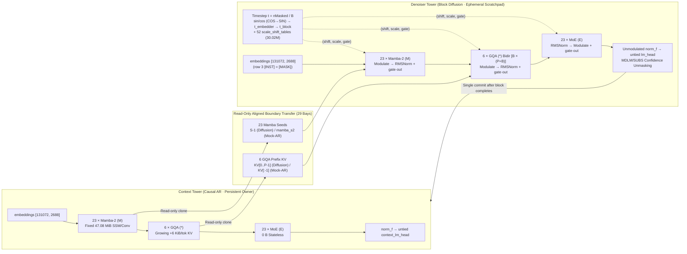

# TwoTower Architecture & Checkpoint Audit Guide

This guide documents the pinned provenance, dual-tower hybrid architecture, supplementary 24-shard safetensors header audit findings, verified discrepancy ledger, educational miniature configuration, and Topology A multi-entry isolation contract for **NVIDIA Nemotron-Labs-TwoTower 30B-A3B-Base-BF16** in this repository.

For the single-tower **Nemotron 3 Nano 30B-A3B** (`v1.0.0`) architecture and WebGL2 pipeline, see [`docs/ARCHITECTURE.md`](ARCHITECTURE.md).

---

## 1. Pinned Provenance

| Artifact | Pinned Identifier | Verification Notes |
| --- | --- | --- |
| **Hugging Face Checkpoint** | `nvidia/Nemotron-Labs-TwoTower-30B-A3B-Base-BF16` | Official BF16 dual-tower release (`createdAt`: `2026-04-11T00:58:51Z`, `lastModified`: `2026-07-01T00:34:48Z`). |
| **Pinned HF Revision** | `35b6498508be8856d380cdfe4a900a79b918d1ea` | Verified current on Hugging Face on `2026-11-25` with zero newer commits (`src/twotower/spec.ts`). |
| **Technical Paper** | `arXiv:2606.26493v2` | *Nemotron-Labs-TwoTower: Diffusion Language Modeling with Pretrained Autoregressive Context*. |
| **Nano v1.0.0 Baseline** | Commit `3be19a3` (git tag `v1.0.0`, Nano HF revision `bf77c317`, `arXiv:2512.20848v1`) | Single-tower causal hybrid backbone kept strictly untouched on `main` and isolated at build time. |

> **Zero Weight Redistribution:** This repository embeds, copies, and redistributes **zero** NVIDIA production checkpoint weights. All browser and Node executions use deterministic synthetic miniature Float32/Float64 tensors (`d = 8`, `V = 34`).

---

## 2. Dual-Tower 52-Layer Hybrid Architecture (`NemotronHTwoTowerForCausalLM`)

`NemotronHTwoTowerForCausalLM` pairs two completely independent (`crossTowerWeightSharing: false`, `tie_word_embeddings: false`) 52-layer hybrid towers built on the exact Nemotron 3 Nano `hybrid_override_pattern`:

```text
MEMEM*EMEMEM*EMEMEM*EMEMEM*EMEMEM*EMEMEMEM*EMEMEMEME
  23 Mamba-2 (M)  ·  23 Granular MoE (E)  ·  6 GQA Attention (*)
```

- **Shared backbone dimensions:** `d = 2,688`, `vocab_size = 131,072`, `NoPE` (no positional embeddings), `max_position_embeddings = 262,144` (`256K`), `layer_norm_epsilon = 1e-5`, `mamba_chunk_size = 128`, `1` double-wide shared MoE expert (`3,712 = 2 × 1,856`) + `128` routed experts (`1,856`, Top-6 active, `moe_routed_scaling_factor = 2.5`).
- **29 Aligned Stateful Transfer Bays vs. 23 Stateless MoE Bays:**
  - **23 Mamba-2 (`M`) bays** (1-based bays `1, 3, 5, 8, 10, 12, 15, 17, 19, 22, 24, 26, 29, 31, 33, 36, 38, 40, 42, 45, 47, 49, 51`): transfer read-only `(convState, ssmState)` boundary seeds (`49,364,992 B` = `47.08 MiB` total fixed Mamba state across 23 bays).
  - **6 GQA Attention (`*`) bays** (1-based bays `6, 13, 20, 27, 34, 43`, 0-based `5, 12, 19, 26, 33, 42`): transfer read-only prefix KV caches (`6,144 B/tok` = `6 KiB/tok` in BF16 across 6 bays).
  - **23 Granular MoE (`E`) bays**: strictly stateless across tokens (`0 B` sequence cache, zero cross-tower transfer).



### Split PixArt-α `adaLN-single` Conditioning Ordering & Canonical Timestep Semantics

Denoiser-only timestep conditioning (`30,022,272` parameters across `58` BF16 tensors) computes:

1. **Canonical Masked-Fraction Timestep (`t = nMasked / B`, NEVER `r / K`):**
   - For any active `mask_diffusion` refinement pass, the canonical scalar is strictly **`t = nMasked / B`** (the empirical masked token fraction entering the executed Denoiser pass — never a step-ratio `r / K`).
   - Spatial view provenance (`TwoTowerTimestepStatus` in `src/twotower/scene/provenance.ts`) strictly separates five concerns:
     - `executedPass`: the executed Denoiser pass's actual input masked fraction (`nMaskedInput / blockSize`), storing any diagnostic `tOverride` separately (`overrideValue` vs `empiricalMaskFraction`) so labels never conflate an override with empirical input counts.
     - `currentBlockMask`: the current record's unresolved `[MASK]` count (post-commit on `diffusion_confidence_commit`).
     - `nextEligibleStep`: populated **only** when an incomplete active block can run another refinement (`nMasked > 0 && remainingSteps > 0`).
     - `blockCompletionState`: `'no_active_block' | 'refining' | 'completed_uncommitted' | 'committed_to_context'` — explicitly noting that no further denoiser evaluation is required once a block is complete.
     - `conditioningMode`: `'active_diffusion' | 'inactive_no_pass_yet' | 'historical_prior_pass' | 'bypassed_ar' | 'bypassed_mock_ar'` — explicitly distinguishing inactive/no-pass-yet records (`context_prefill`, `diffusion_block_init` before pass 0, or ready states) from genuine `AR` / `Mock-AR` bypass (`tModel = null`).
2. **Sinusoidal frequency embedding**: `t_scaled = t * 1000`, `ω_k = exp(-ln(10000) · k / (freqDim / 2))`, ordered **`[cos(0..half-1), sin(0..half-1)]`** (`freqDim = 256` production, `16` miniature).
3. **Global projection**: `t_repr = t_embedder.mlp(φ)` (`freqDim → d → d`, SiLU) and `t_emb = t_block(SiLU(t_repr))` (`[3 · d]`).
4. **Per-layer modulation**: `(shift_l, scale_l, gate_l) = scale_shift_tables[l] + t_emb` for each layer `l ∈ [0..51]`, with `modulate(x, shift, scale) = x * (1 + scale) + shift`.
5. **Exact split normalization ordering** (critical to match `modeling_nemotron_twotower.py` and verified by order-inversion sensitivity parity tests):
   - **Mamba-2 (`M`, 23 layers) & GQA (`*`, 6 layers):** **`modulate → RMSNorm`** (`RMSNorm(x * (1 + scale) + shift)`).
   - **MoE (`E`, 23 layers):** **`RMSNorm → modulate`** (`RMSNorm(x) * (1 + scale) + shift`).
   - **All 52 layers:** residual gating `x + gate * mixer_out`.
   - **Output bookend:** final `norm_f` is **unmodulated** and projects through Denoiser's independent untied `lm_head`.

### Three Execution Modes & Production Memory Accounting

| Execution Mode | Active Towers (BF16 Weights) | Persistent Context Cache | Ephemeral / Extra State | Semantics |
| --- | --- | --- | --- | --- |
| **`ar`** | Context only (`58.82 GiB` / `63,155,886,464 B`) | `47.08 MiB` Mamba + `P × 6 KiB` KV | `0 B` | Standard causal autoregressive prefill & decode (`S = 1` or block commit). |
| **`mock_ar`** | Both (`117.69 GiB` / `126,371,817,472 B`) | `47.08 MiB` Mamba + `P × 6 KiB` KV | **`+47.08 MiB`** (`mamba_s2` pre-last-token snapshot) | Denoiser runs `S = 1` causal pass on `lastTokenId` seeded from `mamba_s2` + `KV[:-1]` with adaLN completely bypassed (`tModel = null`, `tEmb = null`). Matches Context AR at **`0` ULP** when weights are unperturbed (`perturbationScale = 0`). |
| **`mask_diffusion`** | Both (`117.69 GiB` / `126,371,817,472 B`) | `47.08 MiB` Mamba + `P × 6 KiB` KV | **`+B × 6 KiB`** ephemeral block KV (discarded every step) | `K` iterative denoising refinements over a `B`-token block starting from `[MASK]×B`. Every refinement `r = 0..K-1` freshly seeds from the SAME immutable Context boundary (`KV[0..P-1]` + `S-1` Mamba), applies bidirectional `[B × (P+B)]` GQA and split adaLN-single conditioning, performs unshifted MDLM/SUBS confidence unmasking, discards scratchpad state, and commits the completed block once to Context Tower (checking post-block EOS `[2, 11]` prod / `33` mini). |

- **Production Compute Precision:** Weights stored in `BF16` (except `46` `FP32` MoE `e_score_correction_bias` vectors); Mamba-2 SSM scan runs in `FP32`; MoE router matmul + sigmoid runs in **`FP64`** (matching Megatron-Core `--moe-router-dtype fp64`).
- **Non-Official Community NVFP4 Reference:** Distinct from NVIDIA's official `117.69 GiB` BF16 checkpoint, community expert-only NVFP4/W4A16 quantization compresses routed MoE experts (~98% of weights) to ~`42 GiB` (~`21 GiB/tower`) while keeping all Mamba-2 layers, GQA layers/KV, MoE routers/shared experts, embeddings/LM heads, and adaLN-single conditioning in BF16/FP32 (`TWOTOWER_COMMUNITY_NVFP4_REFERENCE`).

---

## 3. Preserved Supplementary Local 24-Shard Safetensors Checkpoint Header Audit

During Stage TT1, a strictly read-only, CPU-only, pure Python stdlib audit inspected all 24 local `.safetensors` shard headers and selective tiny slices (`44,147,048 B` / `42.10 MiB` total I/O = `0.035%` of `126.37 GB` disk size; zero full-shard loads, zero GPU/inference, zero raw weights exported or redistributed). Its verified aggregate findings are preserved in `TWOTOWER_SPEC.directlyInspectedMetadata.localCheckpointHeaderAudit` (`src/twotower/spec.ts`) and summarized below.

### Global Header & Provenance Verification (`0` Integrity Errors)

| Metric | Verified Value | Cross-Check |
| --- | ---: | --- |
| **Safetensors Shards** | **`24`** | `24/24` LFS file sizes, commit (`35b64985`), and SHA-256 etags match HF tree. |
| **Non-Weight Repo Files** | **`15 / 15`** | `100%` SHA-256 byte-identical to HF revision `35b6498508be8856d380cdfe4a900a79b918d1ea`. |
| **Total Tensors** | **`12,544`** | `6,242` `context_tower` + `1` `context_lm_head` + `6,242` `denoiser_tower` + `1` `lm_head` + `58` time-conditioning (`0` extra, `0` missing). |
| **Total Parameters** | **`63,185,902,848`** (`63.19B`) | `2 × 31,577,940,288` independent towers + `30,022,272` denoiser time-conditioning (`0` delta vs. analytical derivation). |
| **Tensor Payload Bytes** | **`126,371,817,472 B`** (`117.69 GiB`) | Exact to the single byte vs. `model.safetensors.index.json` `metadata.total_size`. |
| **Safetensors Header Bytes** | **`1,679,536 B`** (`1.68 MB`) | All 24 headers + 8-byte length prefixes; contiguous non-overlapping offsets to exact EOF. |
| **Total Shard Disk Bytes** | **`126,373,497,008 B`** | `126,371,817,472 + 1,679,536 = 126,373,497,008 B` (`0` integrity errors). |
| **`BF16` Tensors** | **`12,498`** (`63,185,896,960` params / `126,371,793,920 B`) | Every tensor except MoE `e_score_correction_bias`. |
| **`FP32` Tensors** | **`46`** (`5,888` params / `23,552 B`) | **Exclusively** the `2 × 23` MoE `e_score_correction_bias` `[128]` vectors (`63,185,902,848 × 2 + 5,888 × 2 = 126,371,817,472 B`). |
| **Mamba Gated Norm Key** | **`layers.{i}.mixer.norm.weight`** | Confirmed `[4096]` `BF16` across all `2 × 23` Mamba layers (NOT `mixer.mixer.norm.weight`). |

### Component Breakdown & Cross-Tower Weight Divergence Highlights

- **Per-Component Byte Footprint:**
  - `context_tower` (`6,242` tensors): `31,225,618,752` params (`62,451,243,392 B`) + `context_lm_head` (`1` tensor): `352,321,536` params (`704,643,072 B`) = **`63,155,886,464 B` (`58.82 GiB`)**.
  - `denoiser_tower` + `lm_head` (`6,243` tensors, symmetric layout): `63,155,886,464 B` + denoiser time conditioning (`58` tensors: `t_embedder` `7,918,848` + `t_block` `21,684,096` + `52 scale_shift_tables` `419,328` = `30,022,272` params / `60,044,544 B` = `57.26 MiB`) = **`63,215,931,008 B` (`58.87 GiB`)**.
- **Trained Timestep Conditioning Dynamics (Shard 24):**
  - Neither `scale` nor `gate` stays near zero in the trained model: `t_embedder` + `t_block` emits a shared positive baseline (`1 + scale ≈ 1.30`, `gate ≈ +0.28`, rising `+0.276 → +0.287` from `t = 1.0` to `0.0625`) while `t` steers `shift` dynamically (`55.1%` relative change, `cos = 0.864`).
  - All 52 `scale_shift_tables` and 52 `norm.weight` pairs independently fingerprint the split **`Mod → Norm` (`M`/`*`) vs. `Norm → Mod` (`E`)** ordering: `E` `scale` RMS (`0.0249`) is `< 0.5×` `M`/`*` (`0.0579` / `0.0553`), while Denoiser `norm.weight` RMS expands `+17.4%` (`M`) and `+24.1%` (`*`) vs. shrinking `-4.2%` (`E`). Late GQA bays exhibit strong residual gating (Bay 43 `scale_shift_tables.gate` mean `+0.347`, all `2,688` channels positive, effective `gate ≈ +0.62–0.63`).
- **Context vs. Denoiser Divergence (All 52 Layers & Special Tokens):**
  - **Repurposed `[MASK]` row (`embeddings.weight[3]`, `[INST]`):** `#1/256` most-diverged special embedding (`RelDiff = 1.118`, `CosSim = 0.011`) — learned nearly orthogonally from scratch in Denoiser, whereas `254` unused special rows weight-decayed to `RMS_den ≈ 0` and ordinary vocabulary rows (`[1000:1128]`) retain `CosSim ≈ 0.586` (`lm_head` `0.592`; active `</s>` row `2` `0.715`).
  - **MoE `e_score_correction_bias` (`FP32`):** Raw `CosSim ≈ 1.0` reflects uniform per-layer mean offset drift (`[+35.6..+50.8]` Context → `[+51.0..+152.1]` Denoiser); mean-centered biases (`b - mean(b)`) show genuine routing reorganization (`centered_cos_sim` mean `0.304`, `centered_rel_diff` `0.972`, tighter `std` `0.0128 → 0.0061`).
  - **Mamba-2 vs. GQA Divergence:** Mamba scalars remain closely aligned (`dt_bias` `cos = 0.9995`, `D` `0.977`, `A_log` `0.927`, Bay 01 `conv1d.w` `0.836`), while **GQA projections diverged most sharply** (`k_proj` `cos = 0.374–0.388`, `v_proj` `cos = 0.361–0.595`, Bay 06 `v_proj` `RelDiff = 2.329`), reflecting the structural shift from causal AR self-attention to bidirectional block + cross-prefix KV denoising attention.

---

## 4. Verified Discrepancy Ledger

All 9 cross-source discrepancies recorded programmatically in `TWOTOWER_DISCREPANCY_LEDGER` (`src/twotower/spec.ts`):

| ID | Topic | Paper / Model Card Claim | Verified Config / Index / Code Fact | Authoritative Resolution |
| --- | --- | --- | --- | --- |
| `adaln_param_count` | `adaLN-single` parameter count | `1.5M` (paper §2.1/§3.2 & README) | **`30,022,272` (`30.02M`)** across 58 tensors (`t_embedder` `7.92M` + `t_block` `21.68M` + `52 tables` `0.42M`) | Report exact `30,022,272` (`30.02M`) and explicitly document the `1.5M` paper/card discrepancy. |
| `shared_experts_count` | MoE shared expert count | `"2 shared experts"` (README) | `n_shared_experts: 1`, `moe_shared_expert_intermediate_size: 3712` (`2 × 1856`); 2 tensors/layer | Model as `1` double-wide shared expert (`3712`), identical to Nano. |
| `total_parameter_count` | Total parameter & byte count | `~60B` (README) / two `30B` towers | **`63,185,902,848` (`63.19B`)**, `126,371,817,472 B` (`117.69 GiB`) payload | Report exact `63.19B` params and `117.69 GiB` BF16 payload (`~58.85 GiB/tower`). |
| `max_context_length` | Max context length | `128K` (README) | `max_position_embeddings: 262144` (`256K`) in `config.json` & `tokenizer_config.json` (NoPE) | Record `262,144` (`256K`) from config while noting the `128K` model card operational note. |
| `confidence_threshold_and_temperature` | Default `γ` & temperature | Paper `γ = 0.8`; card `γ = 0.8, T = 0.1` | Reference code defaults to `confidence_threshold = 0.9`, `temperature = 0.0` (greedy) | Expose configurable `γ` and `T` with presets for mini demo (`0.22`), paper (`0.80`), and reference code (`0.90`). |
| `adaln_rmsnorm_ordering` | Split `modulate` vs. `RMSNorm` | Generic PixArt-α description | Code runs `modulate → RMSNorm` on `M`/`*` vs. `RMSNorm → modulate` on `E`; unmodulated `norm_f` | Enforce exact split ordering in both TS kernels and PyTorch parity tests. |
| `moe_router_precision` | MoE router compute dtype | Backbone MoE (unspecified) | Code casts hidden states & router weights to **`FP64`** (`--moe-router-dtype fp64`); `e_score_correction_bias` stored in `FP32` | Record production router compute as `FP64` (distinct from Nano v1 `FP32`) via explicit `RouterPrecisionPolicy`. |
| `special_tokens_mask_and_eos` | `[MASK]` & EOS token IDs | Symbolic `[MASK]`, `mask_token_id = 3` | `tokenizer_config.json` `mask_token: null` (ID `3` is `[INST]`); EOS is `2` (`config.json`), `11` (`tokenizer_config.json`), `[2, 11]` (`generation_config.json`) | Document repurposed `[INST]` (`3`) and EOS `[2, 11]`; support scalar or array EOS IDs post-block. |
| `mamba_chunk_size_and_training_tokens` | Mamba `chunk_size` & training tokens | Paper `S = 16` training match; `~2.1T` vs. `~1.4T` (§2.3) | `chunk_size: 128` in `config.json` & inference FP32 chunk-scan; released 3-stage checkpoint `~2.1T` | Record `chunk_size = 128` at inference (noting `S = 16` training) and `~2.1T` (noting §2.3 `1.4T`). |

---

## 5. Miniature Educational Simulator Parameters (`TWOTOWER_MINI_CONFIG`)

To run complete 52-layer dual-tower block-diffusion trajectories interactively in milliseconds with zero network or GPU dependencies, the educational miniature simulator uses deterministic synthetic Float32/Float64 weights (`src/twotower/parameters.ts`):

| Parameter | Miniature Value | Production Reference | Purpose |
| --- | --- | --- | --- |
| Hidden dimension `d` | **`8`** | `2,688` | Exact match to Nano v1.0.0 miniature kernels. |
| Vocabulary `V` | **`34`** (`0..31` Nano `MINI_VOCAB`, **`32` `[MASK]`**, **`33` `<eos>`**) | `131,072` (`MASK=3`, `EOS=[2,11]`) | Preserves Nano's 32 educational tokens plus dedicated mask/EOS sentinels. |
| Timestep `freqDim` | **`16`** | `256` | Compact sinusoidal cos/sin projection (`8 cos + 8 sin`). |
| KV capacity stride | **`24`** (`kvCapacity = 24`) | `262,144` | Fits `P = 8` prompt + multiple `B ∈ {4, 8}` diffusion blocks in `128×128` GQA atlases. |
| Prompt / Block / Steps | **`P = 8`**, **`B ∈ {4, 8}`** (default `4`), **`K` independent** (default `4`) | `B = 16`, `K = 16` | Decouples `K` from `B` so users can inspect `K < B`, `K = B`, and `K > B` budget floors. |
| Confidence threshold `γ` | **`0.22`** calibrated miniature default | `0.80` (paper) / `0.90` (code) | With `V = 34` synthetic logits, `γ = 0.22` yields informative multi-step unmasking & early completion while preserving `0.80` / `0.90` presets. |
| Sampling temperature `T` | **`0.0`** default (greedy); deterministic Gumbel-max when `> 0` | `0.0` (code) / `0.1` (card) | Strict zero `Math.random()`; caller supplies explicit uniform variates when `T > 0`. |
| Canonical weights | **`860` tensors / `600,120` Float32s (`2.29 MiB`)** | `12,544` tensors / `63.19B` | Context (`seed = 0x4e454d33`), independent Denoiser via deterministic in-generation perturbation `{ seed: 20260701, scale: 0.15 }`, plus `58` time-conditioning tensors (`seed = 0x54543031`). |

### Miniature Model Logical Head/State Inventory vs. Selected Spatial Atlas Slices

All Stage TT3/TT4 spatial views distinguish the miniature model's **complete logical inventory** (`TWOTOWER_MINI_MODEL_INVENTORY` in `src/twotower/scene/provenance.ts`, derived directly from `GQA_SIM_CONFIG` and `MAMBA_SIM_CONFIG`) from the **selected subset of head slices** rendered on individual inspection plates:

| Layer Kind | Complete Miniature Logical Inventory | Production 30B-A3B Inventory | Spatial Atlas Packing & Selected Slice Scope |
| --- | --- | --- | --- |
| **GQA Attention (`*`, 6 bays)** | **32 miniature GQA query heads**, **2 KV heads** (`16:1` grouping), **head width `dHead = 4`** (`qConcatDim = 128`, `kvConcatDim = 8`) | `32` Q heads, `2` KV heads (`16:1`), `dHead = 128` (`qConcatDim = 4,096`, `kvConcatDim = 512`) | `128×128` RG32F GQA atlas packs all `32` Q heads (`Q00..Q31`) and both KV heads (`K0/V0`, `K1/V1`), while displaying **2 selected Q-head slices** (`group0Head`, `group1Head`, 1 per KV group) on the Scores/Softmax matrices. |
| **Mamba-2 (`M`, 23 bays)** | **16 miniature Mamba heads (`H00..H15`)**, **8 Mamba groups (`G0..G7`, `2` heads/group)**, `dHead = 4`, `dInner = 64`, `dState = 4`, **`4×4` per-head FP32 SSM state matrices**, 4-tap `convDim = 128` Conv1D | `64` heads, `8` groups (`8` heads/group), `dHead = 64`, `dInner = 4,096`, `dState = 128` (`64 × [64×128]` FP32 SSM), 4-tap `convDim = 6,144` Conv1D | `256×128` RG32F Mamba atlas packs all `16` heads (`xHeads`, `dt`, decay bank, bank summary) and all `8` groups (`B`, `C`, `rms_gate`), while displaying **1 selected head's native `4×4` analytical SSM decomposition slice**. |
| **Granular MoE (`E`, 23 bays)** | `128` routed experts (`Top-6`, `×2.5`, `FP64` router + `FP32` bias) + `1` double-wide shared expert (`0 B` stateless) | `128` routed (`1,856`) + `1` shared (`3,712`), `0 B` stateless | Full `128+1` bank rendered directly; zero cross-tower cache transfer. |

---

## 6. Topology A Multi-Entry MPA, Isolation Contract & Ownership Architecture

### Topology A Multi-Entry Vite MPA

Rather than merging TwoTower into Nano's bundle, `vite.config.ts` compiles two isolated HTML entry points under `build.rollupOptions.input` while preserving `base: process.env.VITE_BASE_PATH ?? '/'`:

| Entry | Source HTML & Boot Script | Root Deployment (`/`) | GitHub Pages Subpath (`/llm-viz/`) |
| --- | --- | --- | --- |
| **Nano v1.0.0** | `index.html` → `/src/main.ts` | `/` | `/llm-viz/` |
| **TwoTower** | `twotower/index.html` → `/src/twotower/app/main.ts` | `/twotower/` | `/llm-viz/twotower/` |

### Automated Nano Bundle-Isolation Contract (`npm run verify:isolation`)

`scripts/verify_bundle_isolation.mjs` inspects the built output directory (`dist/` by default, or `--dir <path>`) and fails CI non-zero on any regression across **7 hard gates**:

1. **Entry Existence:** Both `index.html` and `twotower/index.html` exist in the build output.
2. **HTML Reference Resolution:** Parses all `<script src>`, `<link rel="modulepreload" href>`, and `<link rel="stylesheet" href>` references across both `/` and `/llm-viz/` base paths.
3. **Full Transitive ES Graph Walk:** Uses TypeScript's ECMAScript AST parser to walk every static `import` / `export ... from` edge (and string-literal dynamic `import(...)` edge) reachable from both entries.
4. **Strict Source-Map Isolation Gate:** Reads every `.map` file in Nano's transitive JS graph and fails if any source path references `src/twotower/` or `twotower/`.
5. **Strict Payload Marker Gate:** Scans every JS and CSS file in Nano's transitive graph and fails if any TwoTower identifier appears (`NemotronHTwoTowerForCausalLM`, `twotower-denoiser-v1`, `twotower-context-v1`, `TwoTowerSession`, `diffusion_block_commit`, `TWOTOWER_SPEC`).
6. **TwoTower Positive Presence Gate:** Confirms TwoTower's transitive JS sourcemaps DO include `src/twotower/` sources (preventing vacuous passes).
7. **Nano Payload Budget Gate:** Computes exact raw and gzip (level 9) byte totals for Nano, TwoTower, and shared chunks; fails if Nano transitive assets exceed **`215 KiB` (`220,160 B`)** gzip (current baseline: `204.65 KiB` gzip total, with only `1.30 KiB` gzip in the shared `src/model/spec.ts` / `src/model/memory.ts` chunk).

### Headless Core vs. Browser App & Ownership / Trace-Origin Architecture

- **Headless Core (`src/twotower/{spec,modulation,sampler,parameters,contracts,execution,index}.ts`):** Pure TypeScript with strictly **zero** DOM, WebGL, `src/scene/`, `src/render/`, or `Math.random()` dependencies (enforced by `tests/twotower-engine.test.ts`). Executable identically in Node (Vitest & PyTorch fixture export) and the browser.
- **Browser App (`src/twotower/app/`):** Isolated browser composition root mounted exclusively by `twotower/index.html`; never imported by `src/main.ts` or any Nano module.
- **Immutable Context Ownership & Conditioning Provenance (`src/twotower/contracts.ts`, `src/twotower/execution.ts`):**
  - `TwoTowerContextSnapshot` owns Context's committed `ctxState` (`HybridDecodeCacheState`) and pre-last-token `mambaS2` boundary snapshot, verified by `snapshotDigest` and Nano's unmodified `validateDecodeCacheState()`.
  - `TwoTowerContextConditioningState` carries explicit `ownerRole: 'context_tower'` and `consumerRole: 'denoiser_tower'`, defensively cloned non-aliased `ArrayBuffer`s across all 29 aligned bays (`6` GQA + `23` Mamba-2), and a cryptographic-style 64-bit `conditioningDigest` — guaranteeing Context-owned caches are never mutated or relabeled as Denoiser-owned.
  - **Lazy Per-Layer Trace Reconstruction (`traceOrigin`):** Primary Context cutaway bays (`[1, 2, 6, 42, 43, 52]`) are retained eagerly (`traceOrigin: 'context_computed'`), while any other Context bay `1..52` is reconstructed on demand from detached internal boundary closures (`traceOrigin: 'context_reconstructed'`) inside a bounded LRU trace cache. Persistent committed cache snapshots are tagged `'persistent_cache'`, and ephemeral Denoiser scratchpad traces are tagged `'denoiser_scratch'`.
  - **Historical Cache Boundary Provenance (`TwoTowerDenoiserPassLookup`):** Whenever the active record has no Denoiser pass of its own (e.g., after `diffusion_block_commit` advancing `P = 8 → 12`, after switching to `ar_step`, or on `diffusion_block_init` of a new block before pass 0), spatial scenes explicitly surface `isHistoricalInspection: true`, `sourceContextPrefixLen`, `sourceContextCacheDigest`, `sourceRecordConfig`, `matchesCurrentContextBoundary: false`, and an explicit `historicalProvenanceWarning` banner/badge. Prior Denoiser conditioning (`KV[0..7]` or `H_7`) is **never** relabeled as belonging to the current Context boundary (`P = 12`), historical `record.configAtStep` is strictly preserved (never `session.pendingConfig`), and pruned Context traces (`pruned_unavailable`) always emit explicit warnings without substituting synthetic traces.
