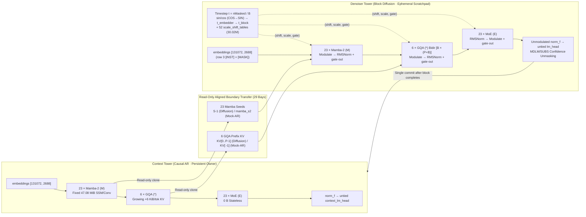

# Nemotron-Labs-TwoTower v1.0.0 — Architecture & Checkpoint Audit Guide

This guide documents the pinned provenance, 3-tier epistemic sourcing contract, dual-tower hybrid architecture, dual SI (`GB`/`MB`) & IEC (`GiB`/`MiB`) checkpoint reconciliation, 3-regime context-length scaling contract, 4-way memory accounting boundary, verified discrepancy ledger, educational miniature configuration, shipped module architecture, and Topology A multi-entry isolation contract for **NVIDIA Nemotron-Labs-TwoTower 30B-A3B-Base-BF16** (`twotower-v1.0.0`).

For the single-tower **Nemotron 3 Nano 30B-A3B** (`v1.0.0`) architecture and shared 5-pass WebGL2 rendering pipeline, see [`docs/ARCHITECTURE.md`](ARCHITECTURE.md). For interactive usage instructions, see [`docs/TWOTOWER_USER_GUIDE.md`](TWOTOWER_USER_GUIDE.md).

---

## 1. Pinned Provenance & 3-Tier Epistemic Sourcing Matrix

### Pinned Reference Identifiers

| Artifact | Pinned Identifier | Verification Notes |
| --- | --- | --- |
| **Hugging Face Checkpoint** | `nvidia/Nemotron-Labs-TwoTower-30B-A3B-Base-BF16` | Official BF16 dual-tower release (`createdAt`: `2026-04-11T00:58:51Z`, `lastModified`: `2026-07-01T00:34:48Z`). |
| **Pinned HF Revision** | `35b6498508be8856d380cdfe4a900a79b918d1ea` | Full 40-char commit pinned across `src/twotower/spec.ts`, verified current on `2026-11-25` with zero newer commits. |
| **Technical Paper** | `arXiv:2606.26493v2` | *Nemotron-Labs-TwoTower: Diffusion Language Modeling with Pretrained Autoregressive Context*. |
| **Nano v1.0.0 Baseline** | Commit `3be19a3` (git tag `v1.0.0`, Nano HF revision `bf77c3174f68ad409e1c2aa60daeb46e32d1c606`, `arXiv:2512.20848v1`) | Single-tower causal hybrid backbone kept preserved on `main` and strictly isolated at build time. |

### 3-Tier Epistemic Sourcing Matrix

Every numerical value rendered in the TwoTower visualizer or documented in this repository belongs to one of three explicit epistemic tiers (`src/twotower/spec.ts`):

| Epistemic Tier | Source & Scope | Exact Examples | Boundary / Non-Redistribution Guarantee |
| --- | --- | --- | --- |
| **Tier 1 · Directly Inspected Metadata** | Verbatim fields from pinned HF JSON/text metadata (`config.json`, `generation_config.json`, `tokenizer_config.json`, `model.safetensors.index.json`) plus a one-time offline, read-only, CPU-only Python stdlib audit of the 24 safetensors shard headers (`44,147,048 B` = `44.15 MB` SI / `42.10 MiB` IEC = `0.035%` of disk size; zero full-shard loads, zero inference). | `hybrid_override_pattern`, `hidden_size = 2,688`, `vocab_size = 131,072`, `max_position_embeddings = 262,144`, `mask_token_id = 3` (`[INST]`), `eos = [2, 11]`, `12,544` tensors (`12,498` BF16 + `46` FP32 `e_score_correction_bias`), `126,371,817,472 B` payload, `1,679,536 B` headers, aggregate cross-tower cosine/RMS statistics. | **Zero production checkpoint weights, raw tensor slices, or tokenizer files are stored in Git or bundled in `dist/`.** |
| **Tier 2 · Analytically Derived Quantities** | Closed-form algebraic calculations derived solely from Tier 1 config shapes, index tensor counts, and documented architectural equations (`src/twotower/spec.ts`, `src/twotower/archReadouts.ts`). | Exact `63,185,902,848` (`63.19B`) total params, `30,022,272` (`30.02M`) time-conditioning params, `0 B` discrepancy vs. `metadata.total_size`, `+11,776 B` FP32 bias surcharge, dual SI/IEC byte sizes, `47.08 MiB` fixed Mamba state, `6 KiB/tok` GQA KV, `8,035`-token crossover, 3-regime context scaling, and 4-way memory boundaries. | Analytical logical payload equations only — explicitly distinguished from full peak inference workspace memory. |
| **Tier 3 · Synthetic Miniature Browser Execution** | Clean-room deterministic TypeScript forward passes (`src/twotower/`, `src/math/`) executed live in browser & Node on synthetic seeded Float32/Float64 weights, verified against independent offline PyTorch `2.15.0` fixtures. | `d = 8`, `V = 34` (`0..31` educational tokens + `#32` `[MASK]` + `#33` `<eos>`), `kvCapacity = 24`, `860` tensors / `600,120` floats (`2.29 MiB`), live activations, GQA/Mamba/MoE/Timestep/Output cutaways, MDLM sampling trajectories (`γ = 0.22` mini default). | Executes NVIDIA's exact mathematical equations at miniature scale — **NOT** `63.19B` checkpoint outputs, real Nemotron tokenizer logits, or calibrated semantic truth. |

---

## 2. Dual-Tower 52-Layer Hybrid Architecture (`NemotronHTwoTowerForCausalLM`)

`NemotronHTwoTowerForCausalLM` pairs two completely independent (`crossTowerWeightSharing: false`, `tie_word_embeddings: false`) 52-layer hybrid towers built on the exact Nemotron 3 Nano `hybrid_override_pattern`:

```text
MEMEM*EMEMEM*EMEMEM*EMEMEM*EMEMEM*EMEMEMEM*EMEMEMEME
  23 Mamba-2 (M)  ·  23 Granular MoE (E)  ·  6 GQA Attention (*)
```

- **Shared backbone dimensions:** `d = 2,688`, `vocab_size = 131,072`, `NoPE` (zero positional embeddings), `max_position_embeddings = 262,144` (`256K` configured positional limit; model card operational note `128K` — see §4), `layer_norm_epsilon = 1e-5`, `mamba_chunk_size = 128`, `1` double-wide shared MoE expert (`3,712 = 2 × 1,856`) + `128` routed experts (`1,856`, Top-6 active, `moe_routed_scaling_factor = 2.5`).
- **29 Aligned Stateful Transfer Bays vs. 23 Stateless MoE Bays:**
  - **23 Mamba-2 (`M`) bays** (1-based bays `1, 3, 5, 8, 10, 12, 15, 17, 19, 22, 24, 26, 29, 31, 33, 36, 38, 40, 42, 45, 47, 49, 51`): transfer read-only `(convState, ssmState)` boundary seeds (`49,364,992 B` = `47.08 MiB` total fixed Mamba state across 23 bays).
  - **6 GQA Attention (`*`) bays** (1-based bays `6, 13, 20, 27, 34, 43`, 0-based `5, 12, 19, 26, 33, 42`): transfer read-only prefix KV caches (`6,144 B/tok` = `6 KiB/tok` in BF16 across 6 bays).
  - **23 Granular MoE (`E`) bays**: strictly stateless across tokens (`0 B` sequence cache, zero cross-tower transfer).



### Split PixArt-α `adaLN-single` Conditioning Ordering & Canonical Timestep Semantics

Denoiser-only timestep conditioning (`30,022,272` parameters across `58` BF16 tensors = `60,044,544 B` = `60.04 MB` SI / `57.26 MiB` IEC) computes:

1. **Canonical Masked-Fraction Timestep (`t = nMasked / B`, NEVER `r / K`):**
   - For any active `mask_diffusion` refinement pass, the canonical scalar is strictly **`t = nMasked / B`** (the empirical masked token fraction entering the executed Denoiser pass — never a step ratio `r / K`).
   - Spatial view provenance (`TwoTowerTimestepStatus` in `src/twotower/scene/provenance.ts`) separates five concerns:
     - `executedPass`: the executed Denoiser pass's actual input masked fraction (`nMaskedInput / blockSize`), storing any diagnostic `tOverride` separately (`overrideValue` vs. `empiricalMaskFraction`) so labels never conflate an override with empirical mask counts.
     - `currentBlockMask`: the current record's unresolved `[MASK]` count (post-commit on `diffusion_confidence_commit`).
     - `nextEligibleStep`: populated **only** when an incomplete active block can run another refinement (`nMasked > 0 && remainingSteps > 0`).
     - `blockCompletionState`: `'no_active_block' | 'refining' | 'completed_uncommitted' | 'committed_to_context'` — noting explicitly when a completed block requires no further Denoiser evaluation.
     - `conditioningMode`: `'active_diffusion' | 'inactive_no_pass_yet' | 'historical_prior_pass' | 'bypassed_ar' | 'bypassed_mock_ar'` — distinguishing inactive/no-pass-yet records (`context_prefill`, `diffusion_block_init` before pass 0) from genuine `AR` / `Mock-AR` bypass (`tModel = null`).
2. **Sinusoidal frequency embedding:** `t_scaled = t * 1000`, `ω_k = exp(-ln(10000) · k / (freqDim / 2))`, ordered **`[cos(0..half-1), sin(0..half-1)]`** (`freqDim = 256` production, `16` miniature).
3. **Global projection:** `t_repr = t_embedder.mlp(φ)` (`freqDim → d → d`, SiLU) and `t_emb = t_block(SiLU(t_repr))` (`[3 · d]`).
4. **Per-layer modulation:** `(shift_l, scale_l, gate_l) = scale_shift_tables[l] + t_emb` for each layer `l ∈ [0..51]`, with `modulate(x, shift, scale) = x * (1 + scale) + shift`.
5. **Exact split normalization ordering** (matching `modeling_nemotron_twotower.py` and guarded by order-inversion sensitivity parity tests):
   - **Mamba-2 (`M`, 23 layers) & GQA (`*`, 6 layers):** **`modulate → RMSNorm`** (`RMSNorm(x * (1 + scale) + shift)`).
   - **MoE (`E`, 23 layers):** **`RMSNorm → modulate`** (`RMSNorm(x) * (1 + scale) + shift`).
   - **All 52 layers:** residual gating `x + gate * mixer_out` leaving the unmodulated skip connection `x` untouched.
   - **Output bookend:** final `norm_f` is **unmodulated** and projects through Denoiser's independent untied `lm_head`.

---

## 3. Decimal SI (`GB`/`MB`) vs. Binary IEC (`GiB`/`MiB`) Unit Reconciliation & 24-Shard Header Audit

To eliminate unit ambiguity across papers, disk tools, and GPU memory profilers, TwoTower `v1.0.0` reports **both Decimal SI (`1 KB = 10³`, `1 MB = 10⁶`, `1 GB = 10⁹`) and Binary IEC (`1 KiB = 2¹⁰`, `1 MiB = 2²⁰`, `1 GiB = 2³⁰`)** side-by-side wherever checkpoint payloads or headers appear:

### Exact Component & Byte Reconciliation Table (`0 B` Audit Discrepancy)

| Checkpoint Component | Tensors | Parameters | Exact Bytes | Decimal SI (`10³`/`10⁶`/`10⁹`) | Binary IEC (`2¹⁰`/`2²⁰`/`2³⁰`) | Notes |
| --- | ---: | ---: | ---: | ---: | ---: | --- |
| **Context Tower** (`context_tower` + `context_lm_head`) | `6,243` | `31,577,940,288` | `63,155,886,464 B` | **`63.16 GB`** | **`58.82 GiB`** | `6,242` backbone + `1` untied `context_lm_head`; includes `23` FP32 biases. |
| **Denoiser Backbone** (`denoiser_tower` + `lm_head`) | `6,243` | `31,577,940,288` | `63,155,886,464 B` | **`63.16 GB`** | **`58.82 GiB`** | Symmetric to Context; zero cross-tower weight sharing; includes `23` FP32 biases. |
| **Denoiser Time-Conditioning** (`t_embedder` + `t_block` + `52` tables) | `58` | `30,022,272` | `60,044,544 B` | **`60.04 MB`** | **`57.26 MiB`** | `t_embedder` `7,918,848` + `t_block` `21,684,096` + `52` tables `419,328` (all BF16). |
| **Denoiser Total** (Backbone + Time-Conditioning) | `6,301` | `31,607,962,560` | `63,215,931,008 B` | **`63.22 GB`** | **`58.87 GiB`** | `63,155,886,464 + 60,044,544 B`. |
| **Grand Total Tensor Payload** | **`12,544`** | **`63,185,902,848`** | **`126,371,817,472 B`** | **`126.37 GB`** | **`117.69 GiB`** | **`0 B` discrepancy** vs. `model.safetensors.index.json` `metadata.total_size`. |
| ↳ `BF16` Tensors (`2 B/param`) | `12,498` | `63,185,896,960` | `126,371,793,920 B` | `126.37 GB` | `117.69 GiB` | Every tensor except MoE `e_score_correction_bias`. |
| ↳ `FP32` `e_score_correction_bias` (`4 B/param`) | **`46`** | **`5,888`** | **`23,552 B`** | **`23.55 KB`** | **`23.00 KiB`** | `2 × 23` MoE `[128]` bias vectors — **`+11,776 B` extra over BF16** (`63,185,902,848 × 2 + 5,888 × 2`). |
| **Safetensors Headers** (`24` shards + 8 B prefixes) | `24` shards | — | `1,679,536 B` | **`1.68 MB`** | **`1.60 MiB`** | Contiguous non-overlapping offsets to exact shard EOF (`0` integrity errors). |
| **Total Shard Disk Footprint** (Payload + Headers) | `24` shards | `63,185,902,848` | `126,373,497,008 B` | **`126.37 GB`** | **`117.69 GiB`** | `126,371,817,472 + 1,679,536 B`; `24/24` LFS sizes & SHA-256 etags verified. |

### Offline Read-Only 24-Shard Safetensors Header Audit Highlights

An offline, strictly read-only, CPU-only Python stdlib audit verified all 24 safetensors shard headers and `15/15` non-weight repo files (`44,147,048 B` = `44.15 MB` SI / `42.10 MiB` IEC total I/O = `0.035%` of disk footprint; zero full-shard loads, zero GPU/inference, zero raw weight values stored or redistributed). Verified aggregate findings preserved in `TWOTOWER_SPEC.directlyInspectedMetadata.localCheckpointHeaderAudit`:

- **Confirmed Mamba Gated Norm Key:** `layers.{i}.mixer.norm.weight` (`[4096]` `BF16`) across all `2 × 23` Mamba layers (not `mixer.mixer.norm.weight`).
- **Trained Timestep Conditioning Dynamics (Shard 24):** Neither `scale` nor `gate` remains near zero in the trained model: `t_embedder` + `t_block` emits a shared positive baseline (`1 + scale ≈ 1.30`, `gate ≈ +0.28`, rising `+0.276 → +0.287` from `t = 1.0` to `0.0625`) while `t` steers `shift` dynamically (`55.1%` relative change, `cos = 0.864`). All 52 `scale_shift_tables` and `norm.weight` pairs independently fingerprint the split `Mod → Norm` (`M`/`*`) vs. `Norm → Mod` (`E`) ordering (`E` `scale` RMS `0.0249` vs. `M`/`*` `0.0579` / `0.0553`; Denoiser `norm.weight` RMS expands `+17.4%` (`M`) and `+24.1%` (`*`) vs. shrinking `-4.2%` (`E`)). Late GQA bays exhibit strong residual gating (Bay 43 `gate` mean `+0.347`, effective `gate ≈ +0.62–0.63`).
- **Context vs. Denoiser Divergence Across All 52 Layers:**
  - **Repurposed `[MASK]` row (`embeddings.weight[3]`, `[INST]`):** `#1/256` most-diverged special embedding (`RelDiff = 1.118`, `CosSim = 0.011`), learned nearly orthogonally from scratch in Denoiser, while `254` unused special rows weight-decayed to `RMS_den ≈ 0` and ordinary vocabulary rows (`[1000:1128]`) retain `CosSim ≈ 0.586` (`lm_head` `0.592`; `</s>` row `2` `0.715`).
  - **MoE `e_score_correction_bias` (`FP32`):** Mean-centered biases (`b - mean(b)`) reveal genuine routing reorganization (`centered_cos_sim` mean `0.304`, `centered_rel_diff` `0.972`, `std` `0.0128 → 0.0061`) beneath uniform per-layer mean offset shifts.
  - **Mamba-2 vs. GQA Divergence:** Mamba scalars remain closely aligned (`dt_bias` `cos = 0.9995`, `D` `0.977`, `A_log` `0.927`, Bay 01 `conv1d.w` `0.836`), whereas **GQA projections diverged most sharply** (`k_proj` `cos = 0.374–0.388`, `v_proj` `cos = 0.361–0.595`, Bay 06 `v_proj` `RelDiff = 2.329`), reflecting the structural shift from causal AR attention to bidirectional block + cross-prefix KV denoising attention.

---

## 4. 3-Regime Context-Length Scaling & 4-Way Memory Accounting Boundary

### 3-Regime Context-Length Scaling Contract

Because TwoTower's model card cites a **`128K`** operational context length while `config.json` configures `max_position_embeddings = 262,144` (`256K`, NoPE), all architectural readouts, charts, and tables enforce **three explicit scaling regimes** (`src/twotower/archReadouts.ts`):

| Regime ID | Token Range | UI Label | Epistemic Status & Interpretation |
| --- | --- | --- | --- |
| **`model_card_operational`** | **`<= 131,072`** (`1K .. 128K`) | `Operational (≤128K)` | Within the published model-card operational context range (`128K`). |
| **`configured_positional_limit`** | **`131,073 .. 262,144`** (`256K`) | `Configured Limit (≤256K)` | Matches `config.json` `max_position_embeddings = 262,144` (NoPE) — **explicitly NOT empirically validated production runtime support**; must never be conflated with validated operational support. |
| **`extrapolated_beyond_max_pos`** | **`> 262,144`** (`512K`, `1M`) | `Extrapolated (>256K)` | Pure analytical linear KV scaling extrapolation beyond the configured positional limit (`+6 KiB/tok` Context GQA KV + `47.08 MiB` constant Mamba-2 state). |

- **Hybrid vs. Pure Transformer Crossover:** Against a 52-layer pure GQA Transformer BF16 KV cache (`52 KiB/tok`), TwoTower's persistent Context cache (`47.08 MiB + 6 KiB/tok`) crosses over at **`8,035` tokens** (`6.05 GiB` vs. `52.00 GiB` at `1M` analytical extrapolation — `~8.6×` smaller persistent cache).

### 4-Way Memory Accounting Boundary (Weights vs. Caches vs. Excluded Runtime Workspace)

TwoTower's memory accounting (`src/twotower/spec.ts`, `src/twotower/archReadouts.ts`) strictly separates **four distinct categories** and never equates logical weight/cache payload totals with complete peak inference memory:

| Category | Owner / Scope | Exact Production Formula (BF16) | Active Modes |
| --- | --- | --- | --- |
| **1. Persistent Context Cache** | `context_tower` (authoritative persistent owner) | **`47.08 MiB`** (`49,364,992 B`) fixed Mamba-2 (`23` bays) + **`P × 6 KiB`** (`6,144 B/tok`) GQA KV (`6` bays); `0 B` for `23` MoE bays. | All modes (`ar`, `mock_ar`, `mask_diffusion`) |
| **2. Optional Implementation-Specific Snapshots & Cross-GPU Mirrors** | Implementation / deployment topology dependent | **(a) `mamba_s2` boundary snapshot:** **`+47.08 MiB`** (`49,364,992 B`, Context pre-last-token Mamba snapshot required only by `mock_ar`; `0 B` otherwise).<br>**(b) Cross-GPU read-only mirror:** up to `1×` Context conditioning payload (`47.08 MiB + P × 6 KiB`) **only** when Context and Denoiser live on separate GPUs without shared logical memory (`0 B` extra cache on single-device logical sharing). | `mock_ar` (`mamba_s2`); multi-GPU split (mirror) |
| **3. Transient Denoiser Block KV** | `denoiser_tower` (ephemeral per-step scratchpad) | **`B × 6 KiB`** (`96 KiB` at production `B = 16`; `24–48 KiB` at miniature `B ∈ {4, 8}`), discarded cleanly at the end of every refinement step. | `mask_diffusion` only (`0 B` in `ar` / `mock_ar`) |
| **4. Total Runtime Workspace / Peak Inference Memory *(Explicitly Excluded)*** | Runtime / framework / hardware allocator | **Excluded from accounted weight + cache totals:** intermediate layer activations, `[B × 131,072]` FP32/BF16 output logits (`~8.0 MiB` FP32 at `B = 16`), CUDA/framework kernel scratchpad, KV paging metadata, and allocator fragmentation/padding. | Always excluded; disclosed explicitly in UI & docs |

### Three Execution Modes Summary

| Execution Mode | Active Resident Weights (BF16) | Persistent Context Cache | Optional Snapshot (`mamba_s2`) | Transient Denoiser Block KV | Semantics |
| --- | --- | --- | --- | --- | --- |
| **`ar`** | Context only (`63.16 GB` / `58.82 GiB`) | `47.08 MiB` + `P × 6 KiB` | `0 B` | `0 B` | Causal autoregressive prefill & decode (`S = 1`); Denoiser & adaLN bypassed (`t = null`). |
| **`mock_ar`** | Both (`126.37 GB` / `117.69 GiB`) | `47.08 MiB` + `P × 6 KiB` | **`+47.08 MiB`** | `0 B` | Denoiser runs causal `S = 1` pass on `lastTokenId` seeded from `mamba_s2` + `KV[:-1]` with adaLN bypassed (`t = null`). Matches Context AR at **`0` ULP** when `ΔW = 0`. |
| **`mask_diffusion`** | Both (`126.37 GB` / `117.69 GiB`) | `47.08 MiB` + `P × 6 KiB` | `0 B` | **`+B × 6 KiB`** (ephemeral) | `K` refinements over a `B`-token block from `[MASK]×B`. Every refinement seeds freshly from the same immutable Context boundary, runs bidirectional `[B × (P+B)]` GQA + split `adaLN-single` + MDLM/SUBS unmasking, discards scratchpad state, and commits once to Context upon block completion (checking post-block EOS `[2, 11]` prod / `33` mini). |

- **Production Compute Precision:** Weights stored in `BF16` (except `46` `FP32` MoE `e_score_correction_bias` vectors); Mamba-2 SSM scan runs in `FP32`; MoE router matmul + sigmoid runs in **`FP64`** (matching Megatron-Core `--moe-router-dtype fp64`).
- **Non-Official Community NVFP4 Reference:** Distinct from NVIDIA's official `126.37 GB` (`117.69 GiB`) BF16 checkpoint, community expert-only NVFP4/W4A16 quantization compresses routed MoE experts (~98% of weights) to ~`42 GiB` (~`21 GiB/tower`) while retaining all Mamba-2 layers, GQA layers/KV, MoE routers/shared experts, embeddings/LM heads, and `adaLN-single` conditioning in BF16/FP32 (`TWOTOWER_COMMUNITY_NVFP4_REFERENCE`).

---

## 5. Verified Discrepancy Ledger

All 9 cross-source discrepancies recorded programmatically in `TWOTOWER_DISCREPANCY_LEDGER` (`src/twotower/spec.ts`):

| ID | Topic | Paper / Model Card Claim | Verified Config / Index / Code Fact | Authoritative Resolution |
| --- | --- | --- | --- | --- |
| `adaln_param_count` | `adaLN-single` parameter count | `1.5M` (paper §2.1/§3.2 & README) | **`30,022,272` (`30.02M`)** across `58` tensors (`t_embedder` `7.92M` + `t_block` `21.68M` + `52` tables `0.42M` = `60.04 MB` / `57.26 MiB`) | Report exact `30,022,272` (`30.02M`) and explicitly document the `1.5M` paper/card discrepancy. |
| `shared_experts_count` | MoE shared expert count | `"2 shared experts"` (README) | `n_shared_experts: 1`, `moe_shared_expert_intermediate_size: 3712` (`2 × 1856`); 2 tensors/layer | Model as `1` double-wide shared expert (`3,712`), identical to Nano. |
| `total_parameter_count` | Total parameter & byte count | `~60B` (README) / two `30B` towers | **`63,185,902,848` (`63.19B`)**, `126,371,817,472 B` (`126.37 GB` SI / `117.69 GiB` IEC) payload | Report exact `63.19B` params and dual SI/IEC byte totals (`63.16 GB`/`58.82 GiB` Context + `63.22 GB`/`58.87 GiB` Denoiser). |
| `max_context_length` | Max context length | `128K` (README) | `max_position_embeddings: 262144` (`256K`) in `config.json` & `tokenizer_config.json` (NoPE) | Enforce the 3-regime contract: `≤ 128K` model-card operational · `128K–256K` configured positional limit (NOT empirically validated runtime support) · `> 256K` analytical extrapolation. |
| `confidence_threshold_and_temperature` | Default `γ` & temperature | Paper `γ = 0.8`; card `γ = 0.8, T = 0.1` | Reference code defaults to `confidence_threshold = 0.9`, `temperature = 0.0` (greedy) | Expose configurable `γ` and `T` with presets for mini demo (`0.22`), paper (`0.80`), and reference code (`0.90`). |
| `adaln_rmsnorm_ordering` | Split `modulate` vs. `RMSNorm` | Generic PixArt-α description | Code runs `modulate → RMSNorm` on `M`/`*` vs. `RMSNorm → modulate` on `E`; unmodulated `norm_f` | Enforce exact split ordering in both TypeScript kernels and PyTorch parity tests. |
| `moe_router_precision` | MoE router compute dtype | Backbone MoE (unspecified) | Code casts hidden states & router weights to **`FP64`** (`--moe-router-dtype fp64`); `e_score_correction_bias` stored in `FP32` | Record production router compute as `FP64` (distinct from Nano v1 `FP32`) via explicit `RouterPrecisionPolicy`. |
| `special_tokens_mask_and_eos` | `[MASK]` & EOS token IDs | Symbolic `[MASK]`, `mask_token_id = 3` | `tokenizer_config.json` `mask_token: null` (ID `3` is `[INST]`); EOS is `2` (`config.json`), `11` (`tokenizer_config.json`), `[2, 11]` (`generation_config.json`) | Document repurposed `[INST]` (`3`) and EOS `[2, 11]`; support scalar or array EOS IDs post-block. |
| `mamba_chunk_size_and_training_tokens` | Mamba `chunk_size` & training tokens | Paper `S = 16` training match; `~2.1T` vs. `~1.4T` (§2.3) | `chunk_size: 128` in `config.json` & inference FP32 chunk-scan; released 3-stage checkpoint `~2.1T` | Record `chunk_size = 128` at inference (noting `S = 16` training) and `~2.1T` (noting §2.3 `1.4T`). |

---

## 6. Miniature Educational Simulator Parameters (`TWOTOWER_MINI_CONFIG`)

To run complete 52-layer dual-tower block-diffusion trajectories interactively in milliseconds with zero network or GPU dependencies, the educational miniature simulator uses deterministic synthetic Float32/Float64 weights (`src/twotower/parameters.ts`):

| Parameter | Miniature Value | Production Reference | Purpose |
| --- | --- | --- | --- |
| Hidden dimension `d` | **`8`** | `2,688` | Exact match to Nano `v1.0.0` miniature kernels. |
| Vocabulary `V` | **`34`** (`0..31` Nano `MINI_VOCAB`, **`32` `[MASK]`**, **`33` `<eos>`**) | `131,072` (`MASK=3`, `EOS=[2,11]`) | Preserves Nano's 32 educational tokens plus dedicated mask/EOS sentinels. |
| Timestep `freqDim` | **`16`** | `256` | Compact sinusoidal cos/sin projection (`8 cos + 8 sin`). |
| KV capacity stride | **`24`** (`kvCapacity = 24`) | `262,144` (config) / `131,072` (card) | Fits `P = 8` prompt + multiple `B ∈ {4, 8}` diffusion blocks in `128×128` GQA atlases. |
| Prompt / Block / Steps | **`P = 8`**, **`B ∈ {4, 8}`** (default `4`), **`K ∈ [1..12]`** (default `4`) | `B = 16`, `K = 16` | Decouples `K` from `B` so users can inspect `K < B`, `K = B`, and `K > B` budget floors. |
| Confidence threshold `γ` | **`0.22`** calibrated miniature default | `0.80` (paper) / `0.90` (code) | With `V = 34` synthetic logits, `γ = 0.22` yields informative multi-step unmasking & early completion while preserving `0.80` / `0.90` presets. |
| Sampling temperature `T` | **`0.0`** default (greedy); deterministic Gumbel-max when `> 0` | `0.0` (code) / `0.1` (card) | Strict zero `Math.random()`; caller supplies explicit uniform variates when `T > 0`. |
| Canonical weights | **`860` tensors / `600,120` Float32s (`2.29 MiB`)** | `12,544` tensors / `63.19B` | Context (`seed = 0x4e454d33`), independent Denoiser via deterministic in-generation perturbation `{ seed: 20260701, scale: 0.15 }`, plus `58` time-conditioning tensors (`seed = 0x54543031`). |

### Miniature Logical Inventory vs. Selected Spatial Atlas Slices

All TwoTower spatial views distinguish the miniature model's **complete logical inventory** (`TWOTOWER_MINI_MODEL_INVENTORY` in `src/twotower/scene/provenance.ts`) from the **selected subset of head slices** displayed on individual inspection plates:

| Layer Kind | Complete Miniature Logical Inventory | Production 30B-A3B Inventory | Spatial Atlas Packing & Selected Slice Scope |
| --- | --- | --- | --- |
| **GQA Attention (`*`, 6 bays)** | **32 miniature GQA query heads**, **2 KV heads** (`16:1` grouping), **`dHead = 4`** (`qConcatDim = 128`, `kvConcatDim = 8`) | `32` Q heads, `2` KV heads (`16:1`), `dHead = 128` (`qConcatDim = 4,096`, `kvConcatDim = 512`) | `128×128` `RG32F` GQA atlas packs all `32` Q heads (`Q00..Q31`) and both KV heads (`K0/V0`, `K1/V1`), while displaying **2 selected Q-head slices** (`group0Head`, `group1Head`, 1 per KV group) on Scores/Softmax matrices. |
| **Mamba-2 (`M`, 23 bays)** | **16 miniature Mamba heads (`H00..H15`)**, **8 Mamba groups (`G0..G7`, `2` heads/group)**, `dHead = 4`, `dInner = 64`, `dState = 4`, **`4×4` per-head FP32 SSM state matrices**, 4-tap `convDim = 128` Conv1D | `64` heads, `8` groups (`8` heads/group), `dHead = 64`, `dInner = 4,096`, `dState = 128` (`64 × [64×128]` FP32 SSM), 4-tap `convDim = 6,144` Conv1D | `256×128` `RG32F` Mamba atlas packs all `16` heads (`xHeads`, `dt`, decay bank, bank summary) and all `8` groups (`B`, `C`, `rms_gate`), while displaying **1 selected head's native `4×4` analytical SSM decomposition slice**. |
| **Granular MoE (`E`, 23 bays)** | `128` routed experts (`Top-6`, `×2.5`, `FP64` router + `FP32` bias) + `1` double-wide shared expert (`0 B` stateless) | `128` routed (`1,856`) + `1` shared (`3,712`), `0 B` stateless | Full `128+1` bank rendered directly; zero cross-tower cache transfer. |

---

## 7. Shipped TwoTower Module Architecture & Topology A Isolation Contract

### Shipped TwoTower Modules (`src/twotower/`)

| Layer | Modules | Responsibility & Purity Boundary |
| --- | --- | --- |
| **Headless Math, Spec & Contracts** | `src/twotower/{spec,modulation,sampler,parameters,contracts,execution,index}.ts` | Pure TypeScript — strictly **zero** DOM, WebGL, `src/scene/`, `src/render/`, or `Math.random()` imports. Runs identically in Node (Vitest & PyTorch fixture export) and browser. |
| **Immutable Session & Readout View-Models** | `src/twotower/session.ts`, `src/twotower/archReadouts.ts` | Copy-on-step `TwoTowerSession` lifecycle, branching, pruning; production dual-unit inventory, 3-regime context scaling, 4-way memory readouts, persistent nested timeline, non-retroactive config scope, and advanced MDLM sampler view-models (strictly `Infinity`-free). |
| **Guided Walkthrough Engine** | `src/twotower/story/walkthrough.ts` | Pure headless 4-Act / 28-Beat tour engine owning a strictly isolated `TwoTowerSession` (`P = 8, B = 4, K = 4, γ = 0.22, T = 0`) with live tensor-derived metrics and zero fabricated outputs. |
| **Pure 3D Spatial Scene Builders** | `src/twotower/scene/{provenance,dualMacroScene,twoTowerGqaAtlas,pairedGqaCutaway,mambaDecomposition,pairedMambaCutaway,timestepCutaway,twoTowerMoeCutaway,twoTowerBookendCutaways,index}.ts` | Emits packed `Float32Array` geometry/atlas buffers and 10-axis CPU ray-pick hitboxes for all 7 spatial views without calling WebGL APIs directly. |
| **Browser Composition Root & Editorial UI** | `src/twotower/app/{main.ts,spatialApp.ts,spatialOverlay.ts,spatial.css,diagnosticUi.ts,diagnostic.css}` | Isolated browser entry mounted solely by `twotower/index.html`; coordinates WebGL2 passes, 3-tab inspector, timeline dock, tour HUD, workbench drawer, telemetry, and quiet `Nano ↗` link. Never imported by Nano. |

### Topology A Multi-Entry Vite MPA & Bundle-Isolation Contract (`npm run verify:isolation`)

`vite.config.ts` compiles two isolated HTML entry points under `build.rollupOptions.input` while preserving `base: process.env.VITE_BASE_PATH ?? '/'`:

| Entry | Source HTML & Boot Script | Root Deployment (`/`) | GitHub Pages Subpath (`/llm-viz/`) | Measured Transitive JS+CSS Gzip (Identical on `/` & `/llm-viz/`) |
| --- | --- | --- | --- | ---: |
| **Nano `v1.0.0`** | `index.html` → `/src/main.ts` | `/` | `/llm-viz/` | **`207.60 KiB`** (`212,585 B` vs. `215.00 KiB` / `220,160 B` hard budget; `7.40 KiB` headroom; `+77 B` gzip CSS for quiet `TwoTower ↗` link, `0 B` Nano JS, `0` leaks, `0` markers) |
| **Shared Nano Primitives** | `assets/overlay-*.js` (`0` TwoTower sources) | Shared chunk | Shared chunk | **`127.27 KiB`** (`130,321 B` gzip / `442,996 B` raw, subset included in both entries) |
| **TwoTower `v1.0.0`** | `twotower/index.html` → `/src/twotower/app/main.ts` | `/twotower/` | `/llm-viz/twotower/` | **`317.76 KiB`** (`325,382 B` / `~318 KiB`, `22` confirmed `src/twotower/*` modules, `0` runtime dependencies) |

`scripts/verify_bundle_isolation.mjs` enforces **7 hard gates** across both root (`/`) and GitHub Pages (`/llm-viz/`) builds in CI and Pages deploy:

1. **Entry Existence:** Both `index.html` and `twotower/index.html` exist in the build output.
2. **HTML Reference Resolution:** Parses all `<script src>`, `<link rel="modulepreload" href>`, and `<link rel="stylesheet" href>` references across `/` and `/llm-viz/` base paths (quiet `<a href>` navigation links are unaffected).
3. **Full Transitive ES Graph Walk:** Uses TypeScript's ECMAScript AST parser to walk every static `import` / `export ... from` edge and literal dynamic `import(...)` edge reachable from both entries.
4. **Strict Source-Map Isolation Gate:** Reads every `.map` file in Nano's transitive JS graph and fails if any source path references `src/twotower/` or `twotower/`.
5. **Strict Payload Marker Gate:** Scans every JS and CSS asset in Nano's transitive graph and fails if any TwoTower identifier appears (`NemotronHTwoTowerForCausalLM`, `twotower-denoiser-v1`, `twotower-context-v1`, `TwoTowerSession`, `diffusion_block_commit`, `TWOTOWER_SPEC`).
6. **TwoTower Positive Presence Gate:** Confirms TwoTower's transitive JS sourcemaps include `src/twotower/` sources (`22` confirmed `src/twotower/*` modules, preventing vacuous passes).
7. **Nano Payload Budget Gate:** Enforces Nano transitive JS+CSS gzip (level 9) `<= 215.00 KiB` (`220,160 B`; measured `207.60 KiB` / `212,585 B`, `7.40 KiB` headroom).

### Immutable Ownership & Historical Cache Boundary Provenance

- **`TwoTowerContextSnapshot` & `TwoTowerContextConditioningState` (`src/twotower/contracts.ts`, `src/twotower/execution.ts`):** Context owns committed `ctxState` (`HybridDecodeCacheState`) and pre-last-token `mambaS2` verified by `snapshotDigest` and Nano's unmodified `validateDecodeCacheState()`. Conditioning states tag `ownerRole: 'context_tower'` and `consumerRole: 'denoiser_tower'`, defensively clone non-aliased `ArrayBuffer`s across all 29 aligned bays (`6` GQA + `23` Mamba-2), and bind them via a 64-bit `conditioningDigest`.
- **Lazy Per-Layer Trace Reconstruction (`traceOrigin`):** Primary Context bays (`[1, 2, 6, 42, 43, 52]`) retain eager traces (`'context_computed'`), while any other Context bay `1..52` reconstructs deterministically on demand (`'context_reconstructed'`) inside a bounded LRU cache. Persistent caches are tagged `'persistent_cache'`; ephemeral Denoiser traces are tagged `'denoiser_scratch'`; pruned Context traces report `'pruned_unavailable'` with explicit warnings and never substitute synthetic traces.
- **Historical Cache Boundary Provenance (`TwoTowerDenoiserPassLookup`):** Whenever the active record has no Denoiser pass of its own (after `diffusion_block_commit` advancing `P = 8 → 12`, after switching to `ar_step`, or on `diffusion_block_init` of a new block before pass 0), spatial scenes surface `isHistoricalInspection: true`, `sourceContextPrefixLen`, `sourceContextCacheDigest`, `sourceRecordConfig`, `matchesCurrentContextBoundary: false`, and an explicit `historicalProvenanceWarning` banner/badge. Prior Denoiser conditioning (`KV[0..7]` or `H_7`) is never relabeled as belonging to the current Context boundary (`P = 12`), and historical `record.configAtStep` is strictly preserved (never overwritten by `session.pendingConfig`).
